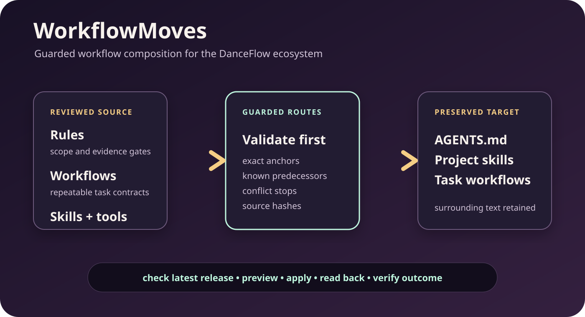

# WorkflowMoves

WorkflowMoves is the guarded workflow layer of the DanceFlow ecosystem. It packages versioned rules, reusable task guides, portable agent skills, validation tools and an additive installer so people and coding agents can adopt new DanceFlow capabilities without replacing project-owned instructions.



*Generated architecture illustration for WorkflowMoves 0.1.34. It explains the package flow; it is not evidence that a particular workspace has installed a route.*

The public repository contains only reusable workflow material. Song audio, artwork, reports, credentials, correspondence, private coordination and rights evidence remain outside it.

## What it adds

- **Guarded installation.** `install.py` validates every selected route before it writes, preserves surrounding text and stops on an unknown or edited managed block.
- **Whole-ecosystem routing.** Maintained guides compose FrameRudiments, StemLab, DanceRudiments, DanceMoves, MediaSlide, PrismMoves, PixelCue and the other DanceFlow packages through their supported contracts.
- **Evidence gates.** Auditors keep generated files, uploads, schedules, public saves, playback, responsive rendering and verified outcomes as separate states.
- **People and agent guidance.** Each route explains the human decision, the supported command, the verification evidence and the limits that remain after a passing check.
- **Reusable improvements.** When a workflow exposes a general gap, the smallest useful fix belongs in the owning tool or this package, with tests and matching documentation.

## Complete tool workflows and development lessons

The [task workflow map](workflows/ecosystem-tool-workflows.md) gives inputs, outputs, acceptance and limits for all seventeen components and the separate DanceFlow toolkit. The [development-learning workflow](workflows/tool-development-lessons.md) generalises verified cases: complete source/asset packaging, immutable editor inputs, canonical rig/character identity, source clocks and tempo families, deterministic asynchronous demos, temporal visual evidence and separate native-host/release acceptance. Private history stays outside the package; unavailable chat bodies remain explicit.

Run `python tools/audit_workflow_coverage.py` from the released package. The standard-library checker derives membership from the capability index and catches a new tool without workflow coverage, duplicate identities, missing local routes and empty contracts. It does not execute tools or validate external links. Preview `python install.py --root WORKSPACE --routes tool-learning-routes.json --check`, inspect the receipt, apply the same manifest, then require a repeat preview to be current. The new guide includes a labelled generated contract diagram; actual native captures remain in the relevant tool examples.

## Explicit completion checks and blog delivery

Version 0.1.39 puts a concise essential-rules summary and the mandatory blogworthiness check at the front of instruction files. Every task and automation records PASS or FAIL with its evidence; passing stories retain an angle, duplicate review and concrete delivery state. `tools/check_blogworthiness.py` checks retained record completeness without claiming editorial merit, rights clearance or public verification. The [illustrated completion guide](workflows/blogworthiness-completion.md) explains the rubric and precise blockers.

Preview the scoped `blogworthiness-routes.json`, `blogworthiness-global-routes.json`, `instruction-summary-routes.json` and `blog-api-routes.json` manifests separately. Global routes use the resolved instruction root. Existing surrounding bytes are preserved; do not raise a discovery limit as a substitute for making the key rules readable first. Existing automation prompts are updated through the supported scheduler tool, preserving their original purpose and every unrelated field. This package does not ship private automation definitions or claim adoption by a running chat.

The [WordPress blog API workflow](workflows/wordpress-blog-rest-api.md) provides reviewed media uploads, draft creation, future scheduling and explicitly authorised immediate publication. It uses encrypted credentials, exact manifest/source hashes, a single committing request and independent readback. Named-zone and UTC checks handle batches across daylight-saving changes. Scheduled articles retain a due-date public-verification queue; API persistence never establishes anonymous rendering or video playback.

`tools/outreach_send_gate.py` provides an atomic venue mutex and permanent original-request claim for cooperating outreach senders. Verified email receipts use persisted message IDs; verified web forms use retained, hash-checked success evidence without inventing an email ID. Read the [duplicate-send workflow](workflows/duplicate-send-gate.md) before use. It does not send messages, grant approval or verify a website.

## Start here

Check the latest [WorkflowMoves release](https://github.com/kieransimkin/WorkflowMoves/releases) before every new workflow run. Download the matching archive and `SHA256SUMS.txt`, verify the checksum, then preview the exact route set before applying it:

```powershell
python install.py --root "Z:\My Songs" --routes tool-adoption-routes.json --check
python install.py --root "Z:\My Songs" --routes tool-adoption-routes.json
```

For people: read the named workflow and its **Potential problems** section, review the check output, then run the write command only for the intended project. For agents: inspect released, installed and imported identities first; use existing DanceFlow primitives; retain exact source hashes; and verify the destination after every write. A clean preview is evidence of a possible installation, not evidence that another workspace or running chat adopted it.

## Visual walkthroughs

The repository includes real or generated media beside the relevant guides. The [FrameRudiments playable pipeline demo](https://kieransimkin.github.io/DanceFlow/framerudiments.html) includes user-controlled playback and a transcript. The PrismMoves section below includes a generated PixelCue measurement figure. Command and public-page evidence is version-labelled wherever it appears.

`tools/clean_epk_video_links.py` removes redundant matching embed links while preserving styled actions, plain caption titles, citations, fallbacks and all player/hero/timing source. Cover composition omits its redundant link. Source preparation never publishes pages.

Version: 0.1.40. StemLab runtime baseline: released 1.6.0 with native DanceRudiments 0.3.0. The runtime wheel, model dependencies and source checkout are separately installed and are not bundled here.

Campaign media now requires a reviewed release-specific design profile, narrative placement before end matter and rendered desktop, tablet and mobile comparison. `tools/integrate_epk_media.py` applies that reviewed profile while proving iframe, video, audio and script blocks remain unchanged. The [illustrated integration example](examples/epk-media-design-integration.md) explains the contract.

\`rules/canonical-metadata-wordpress-sync.md\` requires same-job WordPress synchronization of verified canonical BPM, lyric/cue timing and critical song metadata. Local canonical storage is not completion. Narrow property-only changes, preserved live content, existing mandatory approval gates and independent editor/public/runtime/hosted-byte verification remain authoritative. Guarded routes install this rule into project instructions and both weekly workflow copies.

`rules/global-browser-cleanup.md` installs the cleanup contract into the Z-side global instructions for every workspace. Empty inventories never certify visible-window cleanup when the user or UI contradicts them; agent closures, independent disappearance and manual cleanup remain distinct.

`rules/browser-tab-hygiene.md` and `workflows/browser-tab-hygiene.md` make tab reuse, ownership-aware same-job cleanup and independent closure verification part of every browser job. Completed job-created windows also close through documented controls where available; connections supporting only tab closure record that limit. Retained tabs need a specific next action or user deliverable and must be reviewed on the next turn. Active work and unsaved forms are preserved. Additive routes reach project instructions, video scheduling and browser recovery. Tab cleanup is not evidence of a connection repair or a diagnosed cause; app-managed helpers and Codex must not be stopped as a generic workaround.

`fragments/browser-recovery-lessons.md` retains dated pre-execution, reset, temporary-path and closed-transport findings, including remedies that did not work. It keeps working access in another chat, verified tab closure, current usage availability and restoration of the failing conversation distinct. Exact operational evidence remains private in the workspace, outside this package.

`fragments/browser-fresh-chat-recovery.md` adds the verified recovery route for an app-managed browser transport that has closed. A user-approved same-directory fork preserves completed actions and reconnects through the documented Browser runtime; helpers must not be terminated. Current authenticated access and the original task's result are verified independently before claiming recovery.

`rules/youtube-tiktok-first.md` makes YouTube and TikTok the first applicable publishing destinations whenever Kieran asks to publish. Additive routes install the rule into project instructions and both video publishing workflows. Destination exclusions, content suitability, evidence-backed posting times, existing approval requirements and same-job EPK reconciliation remain authoritative; record an inapplicable platform or verified blocker and continue the remaining authorised work.

`rules/blog-artwork.md` and `fragments/blog-artwork.md` require fresh pictorial featured artwork for ordinary blog articles. Useful rendered summaries and evidence diagrams remain supplementary body media. The guarded routes install this preference into project instructions, both blog-writer skill copies and the publication-verification workflow. `examples/blog-artwork.md` shows how a publicity roundup can combine original illustration, a factual summary and readable source links.

`tools/audit_epk_layout.py` and the read-only `tools/collect_epk_layout.js` enforce a nine-width responsive gate, including five phone widths. They check actual viewport/capture dimensions, text and control clipping, declared artwork/content alignment, image readiness and reviewed below-fold content. See `workflows/epk-responsive-layout-qa.md`. The combined evidence checker uses this same gate; legacy single-phone records no longer pass.

`tools/audit_epk_evidence.py` checks recorded painted phone responses for every declared spatial consumer, lifecycle resets, exact metadata timing sources, parser and metadata-only switching evidence, multi-track associations and responsive observations. It rejects partial sensor attachments and keeps synthetic evidence separate from physical delivery. See `workflows/epk-evidence-gate.md` and the generic JSON example. It does not automate a browser or certify public persistence, rights or keyword demand.

`rules/epk-mobile-motion.md` requires each EPK job and recurring audit to verify suitable mobile sensor connections, permission handling, visual consumers, independent desktop input and lifecycle gates. `workflows/epk-mobile-motion.md` records the verification and exact publication procedure. The rule installs into AGENTS.md, weekly sync, the capability audit and pointer gate.

`rules/automatic-publicity-publication.md` supplies standing approval for verified publicity-only EPK additions in every song campaign and EPK audit job. Original-source verification, public-use eligibility, fresh-source preservation and persisted public responsive checks remain mandatory. The rule explicitly qualifies older separate-confirmation wording; unrelated changes retain their gates. Its additive routes preserve all previous rules and private operational records. See `examples/automatic-publicity-publication.md`.

`rules/immediate-publicity-reconciliation.md` requires same-job evidence capture, ledger reconciliation and EPK staging whenever song publicity is verified. `workflows/verified-song-publicity.md` preserves attribution and reuse limits; its approval step now uses the limited standing publicity permission when all preservation checks pass. The rule installs into project instructions, the coverage archive, the reply audit and weekly sync. `tools/publicity_inventory.py` inventories local marketing text with source hashes, candidate lines and explicit unavailable/skipped records. Matches never establish a verified outcome; original-source review remains required. The scanner rejects missing roots so an invalid path cannot appear to be an empty successful audit.

`rules/epk-timing-metadata.md` makes WordPress-selected metadata the single timing-source authority. `tools/audit_epk_timing_bindings.py page.html --configured-url URL` is a read-only offline preflight for hardcoded timing literals, including relative LRC/CUE paths and selected JSON URLs. A passing preflight does not prove attachment identity, parser success, artist approval or runtime association; the workflow requires those separately. The plugin-generated `dance-moves-core-js-extra` metadata script is the only script exemption. Page-local timing attributes and downloads must bind to the supported runtime configuration; unavailable metadata must not fall back to a literal. Install this rule additively into AGENTS.md and the weekly release workflow through the existing guarded routes.

`workflows/stemlab-audio-motion-recordings.md` routes arbitrary-dimensional native recordings, stem-pair batches, fixed-reference smoothing comparisons, master/percussion beat evidence and the shared trajectory/bar/timeline display controls. `workflows/stemlab-phrase-and-clip-evidence.md` routes phrase-complete auditions, explicit listening feedback and soundtrack-offset matching without promoting hypotheses to approval. Both keep source-clock provenance and existing deployment gates. New controls require fresh exported HTML; installing packages does not update saved viewers or live EPKs.

Install only this reviewed integration with `python install.py --root "Z:\My Songs" --routes stemlab-routes.json --check`, then omit `--check` to apply. A selected manifest must stay inside the package; all selected routes preflight before writes and preserve unselected files. Use this scope when unrelated workflows have independent owners or holds. `previous/0.1.17/` supplies exact known predecessors; modified managed text remains a conflict. The launcher requires a separately provisioned checksum-verified environment at `Tools/stemlab-runtime-1.5.0/.venv`; packages/model dependencies are not bundled.

`workflows/stemlab-rudiment-motion-selection.md` is the shared motion-selection contract. `routes.json` defines additive insertions into the existing video, EPK, analysis, sprite, Canvas and shared-template workflows and their discoverable skill copies. `rules/github-publication.md` is the project-wide GitHub completion rule. `tools/StemLab.ps1` installs to the workspace's Tools directory.

Use `python install.py --root "Z:\My Songs" --check` to inspect integration status and `python install.py --root "Z:\My Songs"` to apply missing additive blocks. Routes with previous_source permit an exact known managed-block/copy upgrade; edited predecessor content remains a conflict. The installer validates every route before writes, preserves existing text and fails on ambiguous anchors or modified managed blocks. It does not install Python packages, publish pages or upload media. Review filesystem permissions and ownership before applying to installed skills.

Run `python -m unittest discover -s tests -v` for the preservation, conflict and repeat-run checks. Release archives contain these exact source files and a checksum manifest.

Campaign-media rules require same-job EPK reconciliation of published videos, YouTube Shorts and social posts. Embed distinct YouTube items wherever permitted; proven same-video cross-posts produce one representative. Unavailable YouTube embeds use verified original files hosted in WordPress, with native controls, approved posters and hosted hash/playback checks. Scheduled items remain pending, and existing public-save gates remain authoritative. See workflows/campaign-media-epk-sync.md. Additive routes cover instructions, publishing and campaign skills, platform monitoring and recurring audits.

## Before every new workflow

Check the latest stable official release and the actual installed/imported version before starting; do not infer currency from a directory name or a development checkout. Read the current release notes, tagged capability documentation and relevant Potential problems. Use the [DanceFlow release preflight](https://github.com/kieransimkin/DanceFlow/blob/main/docs/workflows/release-preflight.md) and [complete capability references](https://github.com/kieransimkin/DanceFlow/blob/main/docs/capabilities/index.md).

People and agents should consider the full ecosystem, use all capabilities that materially serve the task, compose supported files/APIs, and improve a demonstrated reusable gap in its canonical tool. Record why no worthwhile change is justified when that is the result. Keep independent tool identities, compatibility, source clocks, privacy, model/download costs and publication/deployment permissions intact. Store weights and model-specific caches in the owning project's ignored `models/`.

## Find your route

[Potential problems](#potential-problems) · [Artwork-first campaign players](#artwork-first-campaign-players) · [Verified master playback bindings](#verified-master-playback-bindings) · [Scheduled jobs and complete tool use](#scheduled-jobs-and-complete-tool-use) · [Fourier frequency-band recordings](#fourier-frequency-band-recordings) · [FrameRudiments offline rendering](#framerudiments-offline-rendering) · [Shared tool adoption](#shared-tool-adoption) · [PrismMoves visual-language evidence](#prismmoves-visual-language-evidence)

## Potential problems

If a Windows checkout reports that an installed copied document differs immediately after a Git update, compare raw bytes and newline style before overwriting it. Version 0.1.1 pins source text to LF with `.gitattributes`, matching the release archive and initially installed copies. For a preserved old checkout, use the downloaded release source or a fresh 0.1.1 checkout; never normalise unrelated workspace files. Linux and Windows CI cover the additive installer. Different instruction text remains a conflict, even when newlines are consistent.

## Artwork-first campaign players

`tools/compose_epk_cover.py` replaces an added, vertically stacked hero player with the original square cover and an accessible Play button. The iframe stays in an inert template until an explicit click; playback is requested on reveal. Return to artwork removes the player and stops it; pagehide resets active covers. Existing source, timing metadata, motion and other videos are preserved. The paired `epk_cover_player.js` is embedded verbatim by the composer, with no animation clock, sensor listener, iframe API polling or plugin deployment.

Example: `python tools/compose_epk_cover.py fresh-page.html --cover-url https://example.invalid/cover.png --cover-alt "Release artwork" --output candidate.html`. Preview and inspect the exact candidate before an approved save. The coverage auditor labels this `deferred_embed_source_present`; that label does not prove playback. Click every player and record an advancing media timeline, buffering/error/age states and responsive cover/reveal bounds. HTTP, oEmbed or iframe load success alone is insufficient.

Cinematic heroes retain their existing frame height and title overlay, with a square cover fitted inside the frame. During video playback the title clears the controls; closing restores it. Existing direct-child cover selectors gain the new wrapper path inside their original scope and media query, retaining their declarations. Use `repair_cover_styles(source)` for a narrow upgrade of a previously composed cover. Compare canonical hero geometry, artwork styling, pointer response and playback/close states at phone, tablet and desktop widths before an approved save.

## Verified master playback bindings

`tools/compose_epk_playback.py fresh-page.html bindings.json --output candidate.html` validates explicit full-master and partial-track associations and attaches the narrow `bind_epk_players.js` adapter. Use DanceMoves 3.1.20 or a verified compatible successor. The original square hero creates its API-enabled iframe only after Play; reveal/close events attach and tear down its shared playback owner. Other YouTube and native players use the same master source, including repeated native audio controls. Lazy below-fold iframes attach when approaching the viewport, preserving lazy loading and avoiding readiness timeouts before their browser load. No page-level cue parser or video polling loop is introduced.

Bindings contain a public master identity and exact programme duration, approved same-site audio references, and one row per verified video with song `offset`, soundtrack `duration` and `playerStart`. Keep original render hashes and trim receipts privately. See `examples/playback-bindings.json`: a 20-second Short beginning 48 seconds into a 120-second song advances song time from 48 to 68. Missing or alternate-version mappings remain explicit holds; playback alone never establishes soundtrack identity. Preserve WordPress-selected timing, existing choreography, mobile input, accessibility and publication gates.

## Scheduled jobs and complete tool use

`workflows/scheduled-danceflow-tool-use.md` maps the complete applicable capabilities of all twelve DanceFlow tools to scheduled campaign, analytics, EPK, lyric, outreach and maintenance jobs. Generic KeywordMoves routes can also serve appropriate work-search/profile/Etsy tasks while preserving HunnyBee entity confinement; benefits and unrelated research remain outside scope. It requires a purpose-specific plan, supported composition and actual integration evidence, including reasoned unavailable/not-applicable states. Existing scope, dates, read-only restrictions, approvals, privacy and costs remain authoritative. DanceVault 1.0.0 has real Apache/nginx acceptance and still requires destination-host validation; ThumbMoves is cache-only; Short Shifter remains independent.

`fragments/scheduled-danceflow-tool-use.md` is the maintained prompt fragment. Apply it through the supported automation update control with a job-specific capability plan; this package does not edit scheduler TOML or ship private job definitions. Preserve every other field and verify persisted configuration. Install the shared guide with `python install.py --root "Z:\My Songs" --routes ecosystem-job-routes.json`, using `--check` first. Scheduler configuration is not proof a job has run or every tool is active.

## Fourier frequency-band recordings

StemLab 1.6.0 adds `record-rudiment --frequency-bands N` for exactly N frequency-derived dimensions from a master or stem. Use the maintained [Fourier guide](workflows/stemlab-fourier-frequency-bands.md), source-rate FFT/window/bucket provenance and the existing native clock/bipolar export. `fourier-routes.json` scopes installation to the verified launcher, three relevant guides and both maintained StemLab skill copies; publish and verify the runtime before applying it. Existing schedule metadata and publication/access gates are preserved.

The CI-generated Arcadians Fourier page demonstrates full-master 4/8/16/32/64/128-channel outputs. The scoped Fourier upgrade also refreshes the existing managed skill block to the1.6.0 baseline and links that example; every recording remains lossless.

## FrameRudiments offline rendering

`workflows/framerudiments-rendering.md` routes new/revised Shorts, Canvas-style
clips and lyric visualisers through the shared FrameRudiments package. The
`framerudiments-routes.json` manifest installs this guide and additive routing
blocks into the six relevant source/installed skills, render contract and two
video workflows. It preserves all original instructions and applies no media
upload, schedule, EPK save, runtime installation or existing-job prompt change.
Use `python install.py --root "Z:\My Songs" --routes framerudiments-routes.json
--check`, then the same command without `--check`, and verify current readback.
The tool and its private inputs are not bundled.

## Shared tool adoption

`rules/use-and-improve-danceflow.md` routes every chat and recurring workflow to useful shared capabilities, including FrameRudiments, and makes worthwhile improvements part of delivery. It preserves task scope and separate live-site/social rules while recording immediate automatic software publication. Install the four guarded targets with `python install.py --root "Z:\My Songs" --routes tool-adoption-routes.json`, using `--check` first. The global target is the canonical Z-side instruction file; leave the existing C-side symlink unchanged. Shared guidance and private notices do not prove adoption by an already-running chat. No scheduler definitions or private coordination records are shipped.

FrameRudiments guidance now covers modular viewport rendering and calibrated Fourier spectra/peak reports. Scoped upgrades replace only the renderer-managed blocks and capability row, preserving another owner's surrounding analysis guidance.

Full-frame Butterchurn/projectM guidance includes lyrics and native animated sprites/atlases, pinned runtimes, exact effect PCM/clocks, feedback replay, final glyph QA and owned-resource cleanup.

The guarded FrameRudiments launcher reads optional `Tools/FrameRudiments/local/effects-runtime.json` and supplies only absent allowlisted process environment variables. Native/browser dependencies remain separately installed and are never bundled in this archive.

## PrismMoves visual-language evidence

PrismMoves calls PixelCue analysis and turns measured colour, texture and composition plus selected model hypotheses into inspectable reports. It adds no competing image-analysis engine. The guarded prismmoves-routes.json installs the launcher, workflow, portable skill, measurement figure and a narrow capability block. Run `python install.py --root WORKSPACE --routes prismmoves-routes.json --check` before applying. Python packages/models are installed separately; no model download or public save is implied.


Generated measurement figure from PixelCue 0.9.0, not a screenshot or semantic-accuracy evaluation. All DanceFlow downloaded weights and model caches belong inside the owning project's models/ directory, ignored with models/ and excluded from source/release packages. Preserve existing paths until a verified migration. See workflows/prismmoves-visual-analysis.md.

The existing assess-visual-identity skill now routes still-image measurements through PrismMoves and PixelCue while preserving its independent-lineage, authority, collection and outlier review. All eleven guarded routes preserve surrounding content; a single-image profile remains distinct from a collection identity assessment.

`framerudiments-profile-routes.json` installs the new preset-response capture and PrismMoves synthesis workflow plus eight additive rendering/analysis/scheduled-job skill routes. Preserve existing route blocks, the published beat adapter, private real-song inputs, condition families and actual tested/untested coverage.


Generated inputs; rendered results belong to each experiment. [Playable pipeline demo with transcript](https://kieransimkin.github.io/DanceFlow/framerudiments.html).


## Full ecosystem release and capability routes

`ecosystem-preflight-routes.json` adds the shared release preflight, complete capability references and full FrameRudiments compositor guide, plus additive root/skill discovery blocks. Preview with `python install.py --root WORKSPACE --routes ecosystem-preflight-routes.json --check`, inspect the receipt, then apply that same manifest and verify a second check reports current. The runtime checker and package installations remain separate from this guarded text installer. Existing model/asset data, job schedules, stop rules and public-save gates are preserved.

## Potbot and Unity integration

The seventeen-component inventory now includes Potbot and DanceFlow for Unity with source-preview and host acceptance status. Current source-pinned README routes, documentation/example inventories and package hashes cover every component. The [joint workflow](workflows/potbot-unity-integration.md) preserves native timing, rig/profile provenance and the planned Potbot MCP consumer.

Preview `python install.py --root YOUR-WORKSPACE --routes potbot-unity-routes.json --check` before applying the exact capability files; use `potbot-unity-guidance-routes.json` for additive project/skill routing. Modified destinations remain conflicts. No route installs engines, downloads models, starts hosts or saves public pages.


Generated contract illustration. Actual Unity Editor/GPU and Potbot service examples require their separately qualified hosts.
