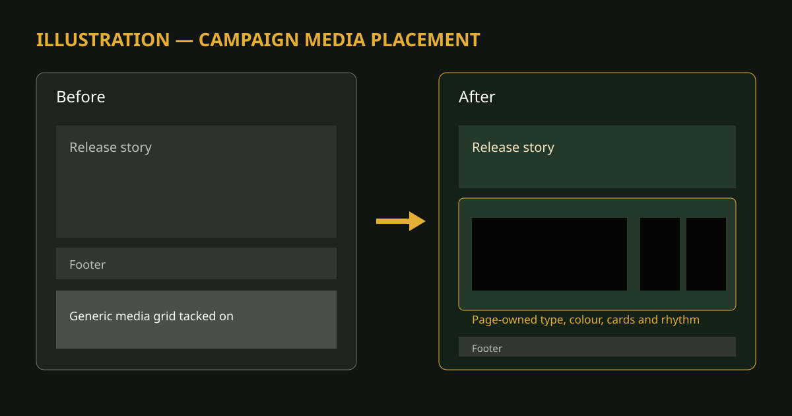
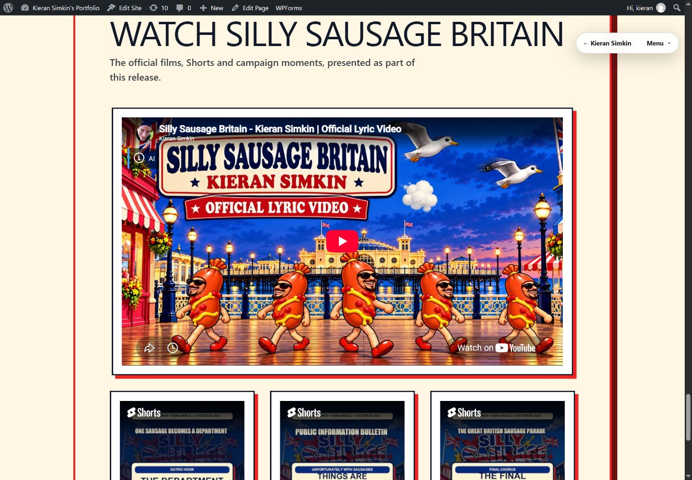

# EPK campaign-media design integration

*Generated schematic illustration, 19 October 2026. It explains placement and hierarchy; it is not evidence of a live page.*

The reviewed profile identifies the page-owned visual tokens and nearby sections before transformation. The bounded helper then moves the existing media block to the approved narrative anchor and applies the reviewed classes and CSS while asserting that iframe, video, audio and script blocks are byte-identical.

Actual before-and-after page screenshots belong in the job evidence record because they may contain release-specific material and are the evidence for rendered comparison. A demonstration video adds no explanatory value to this static placement/style change; playback is checked separately with user-controlled players.

*Actual live WordPress result after publication on 19 October 2026. The full lyric film receives the wide lead position; three Shorts continue as a portrait gallery before the page footer.*
