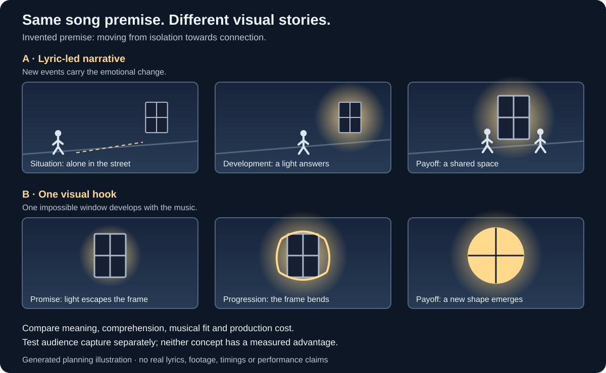

# Source assets, prepare prompts and make GPT baselines

Read when a storyboard needs scene assets, not only finished panels. The skill owns the selected board's asset preparation. The handoff must make the needed files and their provenance usable by the next production step.

*Generated planning illustration, not prepared assets. The recurring window can share an identity across shots while backgrounds, characters and changed states receive their own asset IDs. Actual generated assets still need their individual GPT baselines.*

## Asset register and sourcing

Assign stable asset IDs and link every required shot/state to them. Reuse an asset across shots when its identity is unchanged; separately identify genuinely new views, poses, expressions, materials or compositions that require generation. Avoid generating a whole library of unused possibilities.

For each asset record its type, shot IDs, purpose, visual requirements, reuse/source/generate decision, local files and hashes, dimensions or 3D format, provenance/licence, reference IDs, prompt files/hashes where needed, baseline outputs/review, production requirements and status. Distinguish `required`, `sourced`, `prompts_ready`, `baseline_generated`, `baseline_reviewed`, `production_ready` and `blocked`; a required asset is never satisfied by a source-search result alone.

Search the current release's approved files first. For a real gap, use supported web search or asset-library APIs narrowly, review candidates for campaign fit and compatibility, then download selected assets and licence evidence through supported routes. Keep attribution beside the asset and in the final credit requirements. Confirm the exact item's licence and any adaptation, reference-upload and redistribution conditions; public visibility and a search filter are not sufficient. Do not invent permission, accept new terms or purchase a route without the existing authority.

Useful starting sources, checked 24 November 2026:

- [Poly Haven asset licence](https://polyhaven.com/license): HDRIs, textures and 3D models have an asset-specific public-use route. Its website example/user renders and logos are separately protected; do not grab those as though they were the downloadable CC0 asset. Verify the individual download.
- [Kenney support/licensing](https://kenney.nl/support): its asset pages and included licence files are the evidence to retain for suitable 2D/3D packs. Confirm that the exact file and format serve the storyboard.
- [Quaternius RPG Character Pack](https://quaternius.com/packs/rpgcharacters.html): an example of a pack listing animated/textured characters, multiple 3D formats and a CC0 badge. Verify the actual selected download and rig; do not generalise one pack's licence or rig state to all releases.

These are source leads, not a mandatory catalogue or a reason to replace suitable campaign artwork. Use other original open-licence repositories when relevant, retaining their exact item and licence records. Learn from source images without copying unrelated brands, identities or restricted elements into the scene.

## Provide the reference images and explain each use

Keep original downloads and approved cover artwork intact. Save every selected reference under the campaign's asset pack with an ID, local path, hash, dimensions and source. Inspect the image itself before relying on it.

For a cover crop, retain the original cover identity/hash, source dimensions, crop rectangle `(x, y, width, height)` in top-left pixel coordinates, resulting dimensions/hash and crop method. Record the precise role: for example, colour/texture only, the silhouette of one object, lighting direction, wardrobe or a setting detail. Exclude cover lettering, unrelated faces and other elements not meant to carry across. Use the maintained supported image/cropping route and retain the resulting file; a written crop instruction is not a provided image.

For an online reference, retain original item page and direct file URLs, creator/title, download date, actual licence URL/text or licence file, attribution and transformation notes. Download only the chosen references, not entire collections. Keep reference-use eligibility separate from eligibility to redistribute the original in a public asset pack. Use private records for restricted inputs and only cleared summaries in public documentation.

Each asset's prompt pack needs a reference table: `R1`, exact file/hash, origin/licence, visual role, borrow these details, do not borrow these details, attachment order, and any provider-specific mapping. Provide the actual images alongside the table or linked local thumbnails. If one image supplies palette and another supplies shape, say so in every prompt. Identify one stable named subject per character reference; avoid passing a multi-view character sheet to a video route that may interpret its views as multiple people. Select the appropriate single view instead.

## Detailed prompts for every generated asset

Complete [the per-asset template](../assets/asset-prompt-template.md) before the first generation call. For each asset and required distinct variant, write fully populated Seedance, Nano Banana and GPT prompt files; template placeholders or a generic campaign-wide style paragraph do not satisfy this step.

The shared brief specifies asset ID and shot role; exact subject/number/action or pose; silhouette and continuity details; composition/framing/perspective/lens or orthographic needs; palette, texture, material and lighting; reference-by-reference usage; canvas/aspect/layer and transparency requirements; lyric-safe negative space; exclusions; and observable acceptance checks. Preserve the same creative intent across the provider versions. State actual API settings separately and verify their support; prose cannot guarantee resolution, alpha or a tool capability.

### Nano Banana: still asset prompt

Use [Google DeepMind's prompt guide](https://deepmind.google/models/gemini-image/prompt-guide/) as a primary starting point. Give a natural-language, complete still-image description, name the subjects and explicitly assign the reference roles. Include the intended aspect and type of output, but do not hardcode a model/version or unsupported parameter across future runs. Record the selected target/version when execution is actually contemplated.

For backgrounds, specify a clean plate and separated foreground/quiet lyric area. For sprites, request one isolated full object with useful padding, a stable viewpoint and genuine transparency where supported. For a 3D concept, specify the view(s) and construction-relevant silhouette/material details; it remains an image brief.

### Seedance: same asset design plus video direction

[BytePlus's Seedance prompt guide](https://ai.byteplus.com/ark/region:ap-southeast-1/docs/seedance-2-0-prompt-guide) describes a video route. Preserve the requested Seedance prompt rather than silently replacing it with an image-model family. Its prompt includes a concrete asset/keyframe appearance, reference-subject mapping, intended shot/time window, motion onset/development/end state, camera, light, continuity and excluded changes. Distinguish an exact first-frame input from an appearance/style reference according to the actual selected model's supported inputs.

For an intended static plate or sprite, describe the static/keyframe design first, then a locked camera and still subject or a clearly separate proposed motion variant. Keep the canonical soundtrack and source-timed animation outside an unverified generative video clock. Preparing this prompt does not run Seedance, produce a PNG, preserve exact lyric sync or prove loop closure. Check current family documentation before later execution; do not assume the documented 2.0 route is the current or available version.

### Built-in GPT: required baseline still

Save the exact GPT prompt using the same reference-led visual specification and Nano Banana still-image intent. Translate provider-specific tokens into explicit reference labels and ordinary prose, recording meaningful adaptations. For Seedance motion ideas choose the specific opening/key pose to depict; a still cannot validate the motion trajectory.

After all required prompt packs are written, invoke GPT's built-in image generation once for each required asset/variant. Follow the available `imagegen` skill and use its built-in tool, not a paid provider, CLI/API call, silent model switch or existing unrelated image. Attach the actual selected references through supported tool arguments, not merely a URL or a sentence claiming they were supplied. Inspect local images first; use `referenced_image_paths` when all are local, otherwise the documented conversation-image mechanism. Do not provide both. Omit both for a genuinely new text-only asset; if an intended reference is missing, record and resolve that gap rather than pretending to have used it.

Set genuine transparent output when requested and supported. Save each result into the campaign pack from the tool-returned location, preserving the original and a versioned output rather than overwriting prior baselines. Retain asset/variant ID, exact prompt hash, reference hashes/order, generation tool and returned identity/path, settings actually used, output hash/dimensions, alpha inspection and review result. Check framing, identity, unwanted text, edge padding, empty lyric space and actual visual match at the intended storyboard scale. Rework only failed items and retain their history.

Keep a visible coverage summary: required generated asset IDs, prompt packs ready, baselines generated/reviewed and exact missing items. Complete each item; do not replace a multi-asset request with one composite illustration. If the tool fails or reaches a limit, preserve completed work and name the affected IDs and recovery. Do not switch providers or imply every baseline exists. External Seedance and Nano Banana prompts remain prepared unless their actual execution is separately authorised.

## Production contracts by asset type

| Asset | Preparation and actual acceptance |
| --- | --- |
| Background / clean plate / mixed-media layer | Required aspect, camera overscan and lyric-safe quiet area; separated foreground when planned; no unwanted embedded titles. Composite representative layers at intended size to review perspective, lighting and text clearance. |
| Object sprite / matte / texture | Correct object/view/scale/pivot/padding and colour treatment; inspect real alpha and edges on contrasting backgrounds. Check faint pixels outside the intended silhouette as well as useful-opacity bounds: transparent corners and an alpha range of 0–255 alone do not prove a clean cutout or clear padding. A painted checkerboard is not transparency. Retain texture colour-space or tileability requirements where relevant. |
| 3D prop / environment | Actual mesh file, supported consumer format, units/up/forward axes, origin, material/texture paths, scale and geometric complexity. Import in the intended host and inspect a relevant view; a concept image cannot close this requirement. |
| Rigged character | Actual mesh, skeleton, skin weights, material files, rest pose, bone mapping and needed animation clips or verified procedural rig route. Import with scripts/auto-execution disabled where applicable; exercise the needed poses/clip and check deformation, contacts, scale and root motion. A thumbnail, turnaround or OBJ alone does not prove a rig. |
| Generated motion / footage | Original provenance and encoded cadence, permitted use, useful source bounds and relation to the canonical audio clock. The GPT still baseline supports appearance review only; temporal and final-file QA remain separate. |

Use the existing verified authoring/import route and maintained compositor contracts. An installed 3D renderer does not prove support for arbitrary rigged files. If creation/retargeting or a compatible host is unavailable, own the concrete search/construction handoff and retain that production dependency; do not present the GPT concept as the model. Ordinary 3D assets belong in the release's asset folders; learned model weights/caches still follow the owning project's ignored `models/` rule.

## Handoff and improvement

Hand off the register, actual sourced files, licence/attribution evidence, supplied reference images and usage notes, all three prompts per generated asset, individual GPT baselines, coverage summary, visual review and remaining production dependencies. A pack can have complete baseline drafts while a rig or later video output is still pending; name both states.

In the run retrospective, inspect search relevance, licence/reference gaps, consistency between prompts, baseline coverage, identity drift, alpha/cropping mistakes, cost or wasted generation and mesh/rig claims. Fix a verified reusable instruction/template gap in the canonical skill through its normal validation and release process. Do not force a change from one aesthetic preference or one provider result.
