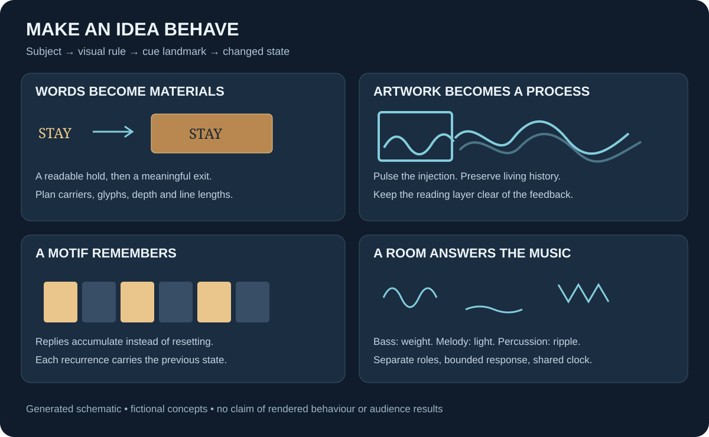

# Creative direction from production history

Use this when recovering a release's previous direction or developing alternatives beyond a familiar visualiser template. Learn the mechanism behind a useful revision; do not turn every past choice into a house style.

*Original generated schematic. The examples are invented planning states, not frames from a campaign or evidence of audience performance.*

## Recover the decisions that defaults missed

Read the relevant production conversation through supported history tools and follow its exact project, adapter, storyboard, provenance and review links. For a requested catalogue-wide review, exhaust available active/archived listings across the relevant sources, screen the metadata, then read candidate messages through their returned cursors. A listing summary is selection evidence, not a message review. Reuse retained research and inspect changed evidence rather than repeating a drive scan. Record oldest-turn coverage, truncation, oversized-turn holds and inaccessible assets explicitly; never bypass a history limit through private application stores.

Extract direct human requests separately from agent proposals, automated prompts, quoted material and outcomes. Old instructions are historical evidence, not renewed authority to render, spend, publish or stop anything. Keep private transcripts, personal references and release-specific paths out of a public skill package.

Build a compact **creative decision register**: source message/turn and date; earlier intended or observed behaviour; requested change and reason; affected shots/assets/controls; later project/adapter values and actual review state; supersession; and scope. If the earlier implementation is unavailable, call the change a requested addition rather than claiming a proven default failure. A request, saved configuration, encoded sample, artist acceptance and audience result remain different evidence.

Carry accepted release decisions into the brief and check them again after rebuilding. Classify a finding as a current explicit requirement, a repeated preference worth considering, a release-only choice, a rejected attempt, or a new hypothesis. Current direction wins. Opposing choices can both be correct: alternating lyric sides may suit one film and be rejected in another; one song needs a more obvious swing while another needs less fractal movement. Do not generalise a particular palette, deity, prop, full-frame effect, reduced motion range or layout switch into a universal rule.

## Generate a mechanism, not a stack of effect names

Start with a performed verb, emotional change, musical relationship, recurring image or approved personal object. Ask what visible rule could embody it. Choose a few relevant operators below, including combinations from different families when useful. Preserve an intelligible opening and a specific changed state or deliberate hold. More complexity is not automatically a better treatment.

| Operator | Productive question and concrete possibility | What the board must resolve |
| --- | --- | --- |
| **A verb changes the world** | What can fold, split, vanish, gather, repair, spill or reconnect at the exact meaningful word? A paper object can unfold into a room; a missing object can leave its silhouette behind. | Setup, visible action landmark, resulting state and later recurrence. Avoid merely swapping a noun sprite on every line. |
| **Words become materials** | Could the lyric be embossed on wood, printed on a receipt, reflected in glass, stitched into cloth or suspended on a physical sign? | Actual font/material treatment, short/long carriers, safe readable hold and entrance/exit. Choose native type over a clean carrier or intentionally generated whole-line lettering according to the accepted brief. |
| **An image becomes a process** | Which semantic region could become a living current, cloud, smoke, reflection or constellation? Could a prop feed a persistent trail before disappearing into it? | Separate masks/seed textures, injection duration, continuous history and clean overlays. Pulse an injection or matte without resetting the whole feedback simulation. |
| **Accumulation, absence and reply** | What remains changed after each refrain? Could lights answer one another, repaired pieces accumulate, or an empty place reveal what has disappeared? | A state ledger across the full song, including the coda. A repeated line can change its meaning without a new location. |
| **Contrasting visual worlds** | Which invariant connects distinct passages, characters or viewpoints? Keep the same radial grammar while changing geometry and palette, or the same camera while the room changes its emotional temperature. | Character/section style definitions, recurring anchors and purposeful departures. Avoid arbitrary recolouring or repeating the same Short with a new title. |
| **A room becomes an instrument** | Could bass move a weighted object, a melody light a filament and percussion disturb a reflection? | Separate source/stem/control roles, phase and bounded transfer functions. Local response should express the audio relationship rather than make every layer bop identically. |
| **Registered light states** | What if the setting stays fixed while bulbs, window replies, bauble flares or reflections breathe with the music? | Locked-camera variants or emissive masks; identical geometry, protected quiet space and smooth source-bound blends. A lighting change must not make furniture jump or pump the whole exposure accidentally. |
| **Camera and scale reveal** | Can a close object reveal a larger context, or can a scene collapse into a single object at its payoff? | Focal path, occlusion, overscan, destination framing and the exact moment the new information becomes readable. |
| **Material transformation as a transition** | Could rain wash one scene away, paper burn into the next or a physical aperture become the next world? | Source/destination surfaces, keyed edges, underlay and completed end state. The transformation should serve the lyric or emotional turn. |
| **Personal artefact, new context** | Can an authorised watch, instrument, drawing, archival render or live-action fragment acquire a different role in this song? | Source/rights, catalogue ownership, crop/lighting/scale continuity and actual source cadence. A reused clip is not a new rig or native 60-fps source. |
| **Controlled variation and restraint** | What can vary at each occurrence while keeping the visual rule? What should become still when the lyric becomes vulnerable? | Bounded ranges, reproducible occurrence seeds, density/intensity hierarchy and a reading interval. Silence, absence and a quiet tableau can be the payoff. |

For an unfamiliar brief, two possible starting points are **a repair that accumulates**—each refrain restores another piece of one broken object—or **an impossible tide**—ink climbs back into a vessel while its shadow continues spilling. These are invented creative hypotheses, not researched winners. Translate either into this song's own imagery, or reject it when the lyric and sound do not support it.

## Make the temporal and layer behaviour concrete

Use the existing cue/action ledger; do not add another scheduler. For each selected mechanism record:

- **Subject and information:** what the viewer recognises at the opening, what changes at the cue and why the next state matters. Include a quiet or sparse alternative when it is a useful comparison.
- **Text system:** campaign typeface or reviewed close match, actual native gradient/stroke/bevel/emboss/shadow treatment, title/artist hierarchy, short/long lyric layouts and contrast at delivered size. Font choice alone does not reproduce cover lettering. Keep editorial text separate from performed words and honour approved line holds/clears.
- **Motion/control system:** the native selection, intended accent/contact rather than just start time, cadence, phase, amplitude, attack/release and source role. Review half/double-time interpretations and phrase accents against the accepted clock. Separate bass movement, treble jitter, lyric micro-motion, atmosphere and major scene events; not every beat needs a full-frame transition.
- **Routing and state:** exact surface and semantic matte, feedback input versus final-output overlay, continuous history versus reset, scene/preset transitions, per-lyric exit, and one-shot or persistent end state. Keep readable lyric information available while decorative echoes transform. An intentional text distortion needs its own readable interval and review.
- **Controlled variation:** define what changes per occurrence—particle seed, emission direction, carrier shape, light state, scale or colour accent—and what stays fixed. Derive seeds from stable shot/cue/occurrence identities so random seeking or rerendering does not invent a new edit. Avoid immediate asset repetition where variety is part of the brief; exact looping still needs compatible entry/exit state.
- **Asset construction:** clean plates, semantic mattes, isolated props, state variants, articulated parts, pivots, rounded/overlapping joints, depth and emission maps as needed. Check articulation and transformed alpha bounds before using fog or blur; those effects are not proof that a malformed limb was repaired.

When the artist deliberately chooses image-generated lettering, preserve that medium instead of silently replacing it with typesetting or an alphabet atlas. Write a complete prompt and baseline for each required line/occurrence variant, compare every delivered glyph/word with canonical text, inspect alpha/crop and long-line readability, and regenerate or explicitly review a failed strip. A prompt containing the right words is not proof that the generated artwork spells them correctly. The canonical timed text and plain subtitle export remain separate from the image asset. Conversely, a clean reusable carrier with native lettering avoids unnecessary line-by-line generation when the brief does not call for unique painted text.

Audition the smallest useful comparison at the real cue: alternate font treatments can be stills, but feedback continuity, particle variation, motion smoothness and disappearing props need sequential playback. Judge perceptual strength as well as presence: a configured effect may be invisible, a nominally beat-synchronised swing may accent the wrong part of its cycle, and too much displacement can flicker. Motion blur on the actual moving subject and a decorative trail solve different problems. Choose deliberate realism or stylisation for fire/water/other materials and use the corresponding maintained native route; a technically successful effect can still be a rejected artistic attempt.

Test the result with the [motion/cue contract](motion-cue-planning.md) and [current native capability plan](tool-capability-planning.md). Keep native previews, normal-speed review, attended listening, artist acceptance and audience metrics separate. This playbook derives reusable creative decisions from production experience; it does not establish that any mechanism improves retention.

## Return the learning to the skill

At the run retrospective, compare new human amendments with the planned register. Did the board omit a material lyric treatment, a prop action, an accepted section change, a routing detail or an asset variant? Was a former correction lost when moving from a sample to the full song or another aspect ratio? Amend the smallest shared instruction/template that would have preserved it and replay a contrasting case. Keep campaign-specific colour, composition and motion preferences in the campaign; retain real audience outcomes under the evidence-and-learning contract. A catalogue-wide research report should map each adopted lesson to private source evidence, the canonical skill change and its validation, with remaining history limits intact.
