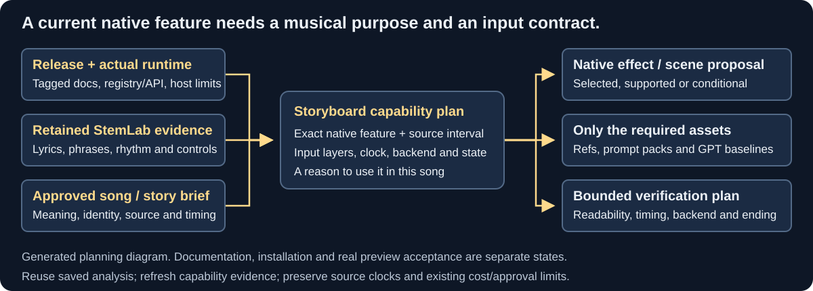

# DanceRudiments motions and cue-point choreography

Use for the storyboard's motion shortlist and cue/action ledger. Make specific visual actions traceable to song evidence and real native movement identities. The output is a proposed choreography plan, not an approved canonical cue file or a completed animation.

*Generated planning-contract diagram. Native motion selection adds an exact movement identity, binding and timed action to this chain; the illustration does not prove a cue has been executed.*

## Find relevant real motions

Check the [official DanceRudiments release](https://github.com/kieransimkin/DanceRudiments/releases/latest), selected package/module path and the versions used inside the actual matcher and renderer. A standalone installation or the default MCP runtime may differ from those consumers. Read current catalogue/rig/recording contracts and the relevant Potential problems; keep older-but-verified support distinct from latest-release availability. Do not upgrade another owner's runtime merely to draft a plan.

Start with accepted choreography and reuse relevant saved StemLab matching evidence. Follow [motion selection](https://github.com/kieransimkin/WorkflowMoves/blob/main/workflows/stemlab-rudiment-motion-selection.md), [audio-motion recordings](https://github.com/kieransimkin/WorkflowMoves/blob/main/workflows/stemlab-audio-motion-recordings.md), and [rig rhythm/loop review](https://github.com/kieransimkin/WorkflowMoves/blob/main/workflows/rig-recording-rhythm-and-loops.md) where appropriate. Inspect the installed command's help before running a bounded match. Saved analysis and standalone audio have different grid/options contracts; a missing result does not authorise new separation or model downloads.

Read the native catalogue and descriptors, then shortlist motions that serve the subject and section. Use the actual native sampler for representative onset, accent, peak/turn, endpoint and negative/seek positions. Do not copy a motion function or catalogue into a private renderer. Preserve the candidate pattern ID, period, dimensions, source/stem, report/schema/hash, grid/window, signal descriptor, ranking/phase, alternative choices and creative reasons. A local best match must cover the intended section; position, velocity and turn matches are different evidence.

Record the actual active output components and the target mapping. For example, a one-dimensional motion may provide its scalar in native `x`; mapping only native `y` can produce a static object even when its description says "vertical". Map that scalar deliberately to screen Y, scale, rotation, opacity or a verified rig channel, with units, sign, amplitude, pivot and maximum extent. Do not equate a catalogue name with a measured human pose or movement of every body part.

| Motion route | What must be identified and verified |
| --- | --- |
| Named looping catalogue pattern | Real native ID, period/dimensions, sampled axes, rate/phase/origin, target transform and selected match evidence. |
| Finite audio-derived or captured motion | Actual recording/hash, native clock and half-open capture bounds, channel/projection mapping, source alignment and non-looping stop behaviour. |
| Typed rig/character action | Exact profile/fingerprint, motion/clip ID, target controls/bone mapping, compatible character/rest pose and actual pose/clip review. An XYZ particle path or sprite image is not a rig action. |
| Desired action absent from verified routes | Retain a specific native-authoring or compatible-clip requirement with owner, proposed composition and acceptance test. Do not invent an available identifier; preserve suitable approved motion or a clearly labelled bounded alternative. |

Every motion should have an intended function: entrance, rhythmic movement, gesture, handoff, impact, camera/object action or deliberate rest. Choose a few relevant alternatives, not a whole-catalogue generation quota. A repeated refrain can preserve a motif while changing scale, phase or binding deliberately; those changes remain separate from the original matched result.

## Identify song cue points and the intended action landmarks

Read canonical cue files, accepted lyric/word timing and the exact master/beat/structure evidence. When the work involves an EPK, retain WordPress-selected timing authority. Use source-bound phrase boundaries, section changes, accents, meaningful words and narrative turns to propose actions. A cue can be useful without being beat-aligned; do not snap an accepted vocal or dramatic moment merely to make the grid tidy.

For each proposed action define what the audience should see **at the cue**: motion starts, a hand points, a sprite reaches its apex, a foot contacts, an object is revealed, a transformation completes or movement stops. Then plan the lead-in, native phase/rate, peak/contact or other landmark, any hold, release and following state. A looping pattern restarted at the cue may not reach its meaningful pose until later. Inspect its native samples or verified rig events to set the phase or start early; do not assume an arbitrary halfway point is the intended accent.

Tag each cue's authority: canonical/accepted source, analysis-derived proposal, editorial proposal or unknown. Retain exact source IDs/timestamps and the reason for the action. Add new proposals to a separate storyboard ledger and keep canonical files unchanged until an authorised adoption. Preserve lyric wording and display grouping; action cues do not rewrite sung text or replace cue/LRC attachments.

## Cue/action ledger

Use the storyboard template's motion-selection and cue tables. Each action needs:

- stable cue/action/shot/target asset IDs and the action's narrative or musical purpose;
- exact timing source/hash, authority/review state and uncertainty; source seconds and native samples, beat/bar coordinates where established, and the cue's particular landmark;
- output time/frame for every actual occurrence, preserving excerpt offset, cuts, repeats or time-map segments; unknown values remain unknown;
- linked native pattern/recording/rig selection, target axes/channels, position/velocity/turn descriptor, rate, amplitude, phase/origin and any authored transform envelope;
- start/lead-in, landmark, hold and release/end; one-shot versus periodic versus finite playback, cue reset versus continuing source phase, repeat/retrigger policy and random-seek reconstruction;
- simultaneous-action ordering, priority or blending for shared controls, bounds/occlusion/lyric clearance, ending/loop behaviour and the smallest outstanding native/visual/listening check.

The Markdown plan can have a linked CSV/JSON companion when useful to production. Keep its field/units contract explicit and translate through the actual FrameRudiments project/adapter API; a planning ledger is not automatically a native executable cue schema. Do not write a second scheduler or motion engine.

## Clock, phase and event semantics

Preserve the release's source clock and accepted beat map. For a linear excerpt, `output_time = source_time - excerpt_start`; cuts, repeats and intentional remaps require an explicit occurrence map. Repeated output occurrences need separate IDs; the single canonical source cue does not become multiple newly accepted cues. Derive frames using the actual rational output rate and preserve any quantisation error separately from the exact source cue.

DanceRudiments uses **64 integer pips per quarter-note beat**. DanceMoves' 16-tick convention is separate. Use the maintained selection workflow's source-beat/window/phase mapping and documented rounding. Do not truncate negative positions towards zero or impose a fixed-BPM clock on a variable-tempo map. A rate/phase change or axis transform must retain the mapping that was actually reviewed; it is not the untouched matcher result.

Named native patterns wrap to their own period. One-shot actions need a bounded gate/envelope and defined before/after states; the pattern's wrap is not permission to fire the action every cycle. Continuous motion may keep source phase across a cue, while an entrance may intentionally restart locally. Finite recordings stop outside their captured extent and must not be silently wrapped, extrapolated or retimed. Persistent transformations need a resolved state when seeking past their cue, not a wall-clock timer that fires again on every draw or seek.

## Verify the plan and hand off

For each important action inspect native values/poses just before, at and after onset, intended landmark and release, including a loop/section boundary where relevant. Check the transformed subject and clean text at intended display size. A native sample proves a value at a pip, not a rendered frame, human contact, physical timing or attended audio synchronisation. Use a bounded native FrameRudiments preview under the rendering skill when the actual action requires visual review; target at least 60 fps and retain exact input/output identities.

Review direct seeks before/inside/after actions, repeated playback, simultaneous cues, the final frame and an actual repeat if intended. Verify no duplicate one-shot fires, no replay beyond a finite capture, no abrupt unintended reset, and no accumulation of additive transforms. Keep rendering, cue acceptance, listening, asset/rig approval and publication states distinct.

Deliver the real motion shortlist, chosen bindings and rejected alternatives, cue/action ledger and any structured companion with source/clock mapping, review evidence and exact remaining dependencies. The per-asset prompts inherit necessary pose, articulation, pivot, overscan and layering constraints. The skill's retrospective must inspect missed cue landmarks, wrong active axes, repeated/late actions, unnecessary analysis and unsupported rig claims, then make the smallest justified reusable correction.
