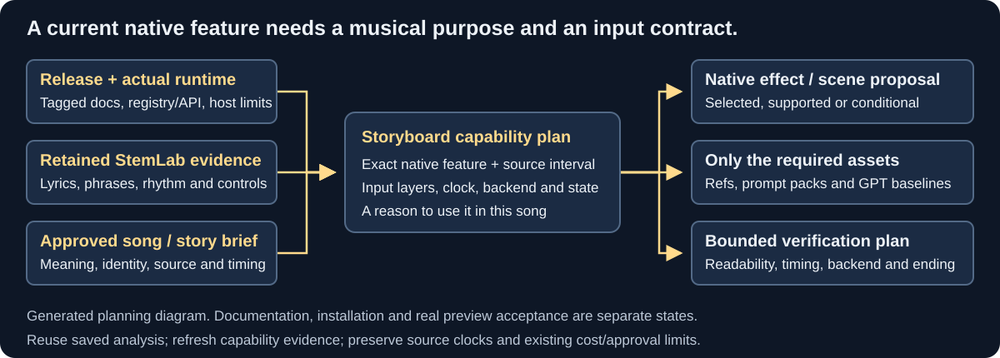

# Current native capabilities and analysis planning

Read before selecting a storytelling treatment, effect or asset-production route. Refresh the exact capabilities relevant to the brief rather than freezing a feature list or version inside this skill. FrameRudiments owns offline composition; StemLab owns audio and timing evidence. This planning pass does not require a new analysis, render, model download or runtime upgrade.

*Generated planning-contract diagram. It describes the required evidence mapping, not a completed render or proof that the illustrated tools are integrated for a particular release.*

## Establish what is current and usable

1. Read the owning project's current tool launchers/configuration, selected analysis/render skills and relevant Potential problems. Use DanceFlow discovery and its release preflight where available. Check the [official FrameRudiments release](https://github.com/kieransimkin/FrameRudiments/releases/latest), [official StemLab release](https://github.com/kieransimkin/stemlab/releases/latest) and [official DanceRudiments release](https://github.com/kieransimkin/DanceRudiments/releases/latest), retaining tag/source identity, date and URLs. Prefer existing configured runtimes to incidental development checkouts; motion matching and rendering can use different native package identities.
2. Observe the exact interpreter/package actually selected: distribution/module version, imported path and launcher/adapter identity. Use the tool's documented version/help interface; if it has no `--version`, read distribution metadata and module identity in that interpreter instead of inventing a command. The release-checker's generic installed observations may omit these runtimes; record fresh explicit observations separately or supply its supported installed mapping.
3. Read the matching tagged README/docs index and complete relevant feature contracts, including input formats and qualification limits. The maintained workflow may cite an earlier release: use it for process and route to the current tagged implementation for exact capability/configuration. A stale "unreleased" milestone heading inside a later release does not alone establish absence or acceptance. Reconcile source inclusion, runtime API, release evidence and remaining native/device qualifications.
4. Inspect supported native inventories or APIs without running models or rendering: FrameRudiments renderer registry, sprite catalogue, visualiser pins and relevant subcommand help; StemLab command/model inventory and saved-report schemas as needed. A CLI or MCP surface may expose only part of the native library. Use the released native API where documented, retaining its exact identity; do not invent a convenience command or duplicate the engine.
5. Write a compact capability matrix: creative need, current released capability/ref, selected runtime, exact native ID/configuration path, source/evidence input, backend/extra/host requirements, readiness and next check. Distinguish `documented`, `installed`, `host_qualified`, `previewed`, `conditional`, `unavailable` and `not_needed`. An installed library does not establish a working optional shader, model, rig, capture device or physical timing route.

Refresh at the render/analysis handoff if the runtime or authoritative evidence changed. Pin the selected project and media; never upgrade, migrate or duplicate a live job to chase "latest". If official checks or a host are unavailable, name the exact limit, keep dependent choices conditional and continue the unaffected creative plan.

## FrameRudiments: choose a native visual mechanism

Read the maintained [feature-selection guide](https://github.com/kieransimkin/WorkflowMoves/blob/main/workflows/framerudiments-rendering-features.md), [rendering workflow](https://github.com/kieransimkin/WorkflowMoves/blob/main/workflows/framerudiments-rendering.md) and full DanceFlow FrameRudiments guide, or their installed `Workflows/` copies. Then follow the selected release's own docs rather than treating any historical feature count or version in those guides as current authority.

| Storyboard need | Native families to inspect in the current release | Decision and evidence to retain |
| --- | --- | --- |
| One striking visual rule or music-responsive motif | Native procedural/rudiment renderers, spectra, particles/emitters, sprite/atlas motion, spatial/3D views, natural materials and procedural fields | Match an exact renderer/control to this source section. State whether it uses measured audio, an authored curve or a native recording; a synthetic spectrum demo is not song analysis. |
| Readable lyric storytelling | Line/word timing, rich lyric effects, indicators, text layers and clear/fade events | Preserve canonical words, acoustic versus display timing, layer order and source clock. Review the longest line, blank state, re-entry and effect extremes. |
| Reveals and scene changes | Native graph mattes/keying, masks, layer animation, style/blending, displacement/warps, matte/spectral/geometric/beat-timed transitions | Name node/configuration, inputs, alpha/depth/map requirements, transition timing and endpoints. Keep clean text above disruptive stages where the treatment calls for it. |
| A single effect hook with evolving history | Butterchurn/projectM routing, native feedback history, frame-addressed temporal effects, time remap/echo/blur/slit-scan families when actually supported | Declare effect order, finite history, seek/replay requirements, source/audio mapping, borders and ending/reset. A still baseline validates appearance only; it cannot prove temporal behaviour or loop closure. |
| A new shader or external filter | The selected release's GL-transition, ISF inspection or supported plugin/filter contracts | Separate metadata inspection from execution. Check trusted-source/hash, ABI, optional runtime, supported parameters and host qualification. Do not infer general ISF execution from `inspect-isf`, or arbitrary plugin support from one native demo. |
| 3D, mixed media and richer scene inputs | Actual asset/import/geometry/AOV, video I/O and colour/alpha contracts; optional vision inputs where relevant | Verify file/rig/format and consumer support. Model-estimated segmentation, relative depth or flow are hypotheses, distinct from renderer-produced geometry/AOVs. No model download is implied. |
| Practical authoring and controlled performance | Authoring workspace, shared timeline, native preview/seek, frame/dependency inspection, timeline interchange, finite OSC/MIDI controls where supported | Distinguish library from UI, preview from final quality, and recorded finite controls from live/physical-device acceptance. Pin source-clock takes and preserve closure/ownership; do not open devices for discovery. |

Inspect current additions beyond these examples when they serve the brief. Do not add every family to every video. Before relying on a chosen effect in production, use the native plan and a bounded representative preflight under the rendering skill, retaining actual backend/fallback and encoded review. GPU selection, an import or a successful metadata command is not visual acceptance. Target at least 60 fps and preserve normal render ownership, cost and source-identity rules.

## StemLab: turn retained analysis into storyboard decisions

Use the maintained `use-and-improve-stemlab` skill and the selected release's analysis/docs index. Start with the release's saved evidence and exact master hash. Discover a missing output before invoking any costly analysis. The following workflows are routing examples; verify their current installed/released contents and Potential problems before use.

| Creative decision | Evidence to inspect | Maintained route |
| --- | --- | --- |
| Where the visual story changes | Structure/section occurrences, harmony/tension, dynamics/timbre, vocal density, lyrics and listening notes | StemLab song/sonic analysis through `use-and-improve-stemlab`; preserve analysis hypotheses and artist/canonical decisions separately. |
| Beat-locked transitions or movement | Accepted tempo/meter/phase, independent detector families, source/stem provenance, tempo changes and native movement candidates | [Motion selection](https://github.com/kieransimkin/WorkflowMoves/blob/main/workflows/stemlab-rudiment-motion-selection.md) and [audio-motion recordings](https://github.com/kieransimkin/WorkflowMoves/blob/main/workflows/stemlab-audio-motion-recordings.md). Preserve DanceRudiments 64-pip sampling versus other clocks and finite recording bounds. |
| Lyric entry, sung-word highlighting and deliberate gaps | Canonical line/word text, retained alignments, acoustic releases, display starts/clears and artist corrections | `review-lyric-timing` / [lyric timing review](https://github.com/kieransimkin/WorkflowMoves/blob/main/workflows/lyric-timing-review.md), with current StemEdit audition and combined line/word LRC where supported. Do not replace accepted timing with an unreviewed ensemble or display proposal. |
| A Short's musically complete local story | Phrase/loop candidates, complete lyric groups, bar/phase evidence and actual seam/restart listening | `find-loopable-song-sections` and [phrase/clip evidence](https://github.com/kieransimkin/WorkflowMoves/blob/main/workflows/stemlab-phrase-and-clip-evidence.md). Keep native sample bounds and zero-accepted-loop outcomes; do not force a loop. |
| Spectral or multi-stem visual controls | Calibrated Fourier/RMS/gain/band metadata, waveform/onset evidence, chosen stem recordings and normalization | [Fourier workflow](https://github.com/kieransimkin/WorkflowMoves/blob/main/workflows/stemlab-fourier-frequency-bands.md) and the current FrameRudiments spectrum/input contract. Bind control units and source time explicitly; image colour-band effects are not audio-frequency analysis. |
| A specific missing musical detail | Existing MIDI/note, activity, pitch, harmony, drum or independent model evidence | Current StemLab MIDI/evidence-model workflows only when the unresolved question warrants them. Reuse saved stems/results; no blanket reanalysis, source separation or model downloads for a storyboard. |

For each selected result record report path/schema/hash, master identity, relevant source interval, confidence/review state and the decision it changes. Derived controls and generated clips retain original sample/second/beat mapping. Never move the audio grid merely to match lyrics/cues, promote a detector score into artist approval, or label automated playback as attended listening.

## Carry the mapping into assets and production

Before writing image prompts, determine which visuals are supplied by a native renderer/effect and which require actual image/mesh/rig inputs. Reuse native compositing, mattes, animation and effects when they express the treatment; do not generate a fake screenshot of an effect and present it as implementation evidence. Native effect selection alone creates no new raster-asset obligation.

For every generated plate/sprite/character, carry the chosen consumer requirements into the shared visual brief: camera/overscan, alpha, pivot/scale, layer order, lyric-safe space and any required depth/matte or geometry inputs. A GPT baseline cannot supply metric depth, skin weights, exact beat response or feedback state. Keep unsupported dependencies explicit. Preserve the required per-generated-asset prompts, supplied references and individual built-in GPT baseline drafts.

Hand off one traceable chain: approved source → saved analysis/cue → storyboard moment → exact current native feature and parameters → required assets → bounded verification plan. Use `render-bpm-cue-videos` for production, `verify-rendered-music-video` for the exact encoded result, `revise-rendered-music-video` for changes and `diagnose-rendered-video-motion` when cadence or effect history needs investigation.

For named, finite or rigged motion, follow [motion and cue planning](motion-cue-planning.md) and deliver the specific native selection plus source-timed action landmarks; generic "dance on the beat" wording does not identify a reproducible action.

In every retrospective, check whether a stale guide, missing registry/API review, repeated analysis or overlooked native effect led to a weaker or more expensive plan. Apply the smallest verified reusable correction to this skill/reference/template; record why no change is warranted when the existing routes meet the need.
