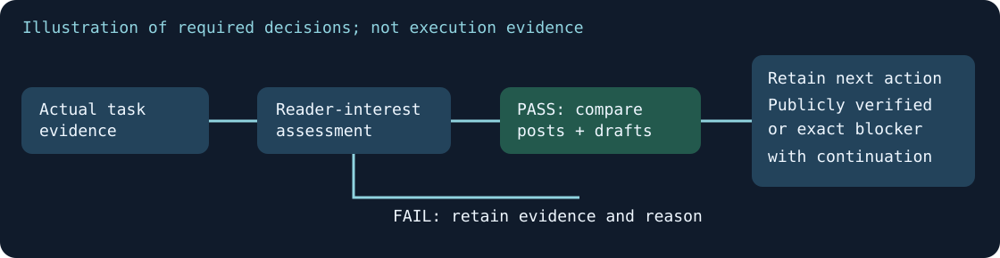

# Blogworthiness at task completion

Assess the actual activity and result before completing every task or automation run. The rule belongs near the beginning of instructions and directly in saved job prompts. Instruction discovery has a size limit, so placing a requirement late in a long file can leave it unavailable to the agent. See the [official instruction discovery guidance](https://learn.chatgpt.com/docs/agent-configuration/agents-md).



*Generated explanatory diagram. It describes the required decisions, not evidence that a task ran, a story passed or a post was published.*

## Make and retain the decision

Use `Blogworthiness: PASS/FAIL — reason` in the existing report or final handoff. Cite the task's real evidence. A modest or unfinished experiment can PASS when its status is accurately described and a reader can learn something. Publicity and workflow improvement are not required.

For PASS, identify the reader-interest angle and public-safe evidence, compare the current blog and pending drafts, then record coverage or the next delivery action. A duplicate story may be recorded as FAIL with the existing post link; meaningful new developments can justify a distinct follow-up. Closely related work may share one article, with every activity mapped to that article. Do not invent a subject to meet a posting quota.

Keep PASS when the story is worthwhile but suitable media or access is missing, and record `blocked` with its exact dependency and continuation. Only independently verified public output earns `verified_live`. Drafts, uploads and schedules remain separate.

Routine scheduling, rule updates and this completion check alone normally FAIL. Private correspondence, rights evidence, credentials, sensitive personal information and intentionally unreleased material remain controlled. Selective public wording does not turn restricted evidence into permission to disclose it.

## Optional structured evidence check

For substantial work or a catch-up batch, retain an assessment JSON object or list and run:

```powershell
python Tools/check_blogworthiness.py path/to/assessments.json
```

Each record contains `task`, `decision` (PASS/FAIL), `reason` and a nonempty `evidence` list. PASS also requires `angle`, `duplicate_check`, `next_action` and `state`. Allowed states are `covered`, `prepared`, `draft`, `scheduled`, `published`, `verified_live` and `blocked`. A blocked PASS requires `blocker`; covered/scheduled/published/verified-live states require `url`. The checker verifies completeness only: it cannot judge story quality, rights, source truth, public playback or another agent's adoption.

## Preserve automation behaviour

Use the supported automation-update tool, never direct TOML edits. Back up the current records privately, prepend the requirement to every existing prompt, then independently compare persisted records. Only `prompt` and the service's update timestamp may change. Preserve active/paused state, schedule, owner, model, project, environment and notification preferences. New automations must include the same requirement. A no-op or quiet job records the assessment through its already permitted channel without forcing a notification or external action.

## Potential problems

- **The rule exists late in a large instruction file.** Put a concise requirement first and in each prompt. Do not inflate the instruction-size setting or claim an already running chat reloaded guidance without evidence.
- **PASS is silently converted to FAIL because publication is blocked.** Preserve the editorial decision and record the exact delivery dependency with a next action.
- **Prompts change but schedules or pause states drift.** Compare all persisted fields with the private before snapshot. Stop on unrelated differences and retain the exact discrepancy.
- **The check becomes a new stream of filler posts.** Require an independent reader-interest outcome and inspect existing posts/drafts. The rule's installation is configuration evidence only.

A screenshot or video of this static decision policy would add no implementation evidence; the explanatory diagram is the useful visual. Task-specific reports should include actual relevant screenshots or demonstrations when they explain the work.
