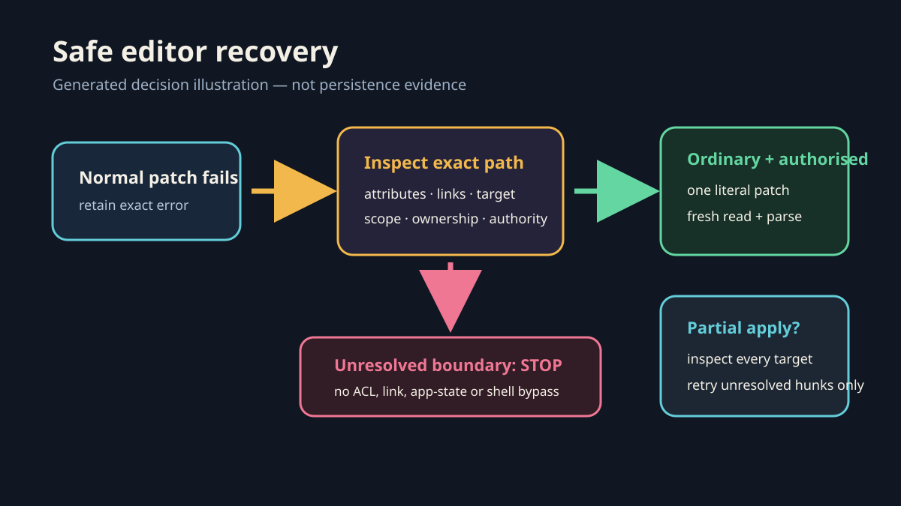

# Campaign patch-save recovery

Use the [safe-editor recovery workflow](campaign-safe-editor-recovery.md) when an exact campaign report, ledger or structured record is readable and authorised but the normal patch adapter reports a write or path-validation failure.

*Generated decision illustration. It is not a write receipt and contains no campaign data. Actual before/after evidence remains private.*

## Recovery contract

1. Treat `Failed to write file`, a reparse-point warning and an access denial as different symptoms. Inspect the exact path and current supported filesystem evidence before selecting a recovery.
2. Preserve other owners' edits. Prepare one literal minimal patch and obtain any required narrowly scoped escalation for that exact destination and mechanism.
3. Resolve the installed patch engine at action time. Do not hard-code a machine/user/version path, use generic shell writes or change ACLs.
4. Assume a multi-file patch may partially apply. Inspect every destination before a retry and never recreate a file that already succeeded.
5. For CSV/JSON/other structured records, preserve byte-order marks and schema, match a stable existing record, re-import/parse the result and verify counts. For Markdown, reread the intended section placement and surrounding content.
6. Record attempted, persisted and validated states separately. An approved fallback does not prove the normal editor defect is repaired.

This route does not authorise protected-path edits, private-data publication, browser/account actions, WordPress saves or a broader workspace mutation.

## Potential problems

- The error message alone cannot distinguish permissions, path validation, link handling or a transport defect.
- Retrying the full original patch after partial success can duplicate records or overwrite newer work.
- A successful patch command without fresh readback leaves persistence unknown.
- A byte-order mark can make a first-line textual match fail even when the visible header looks identical.
