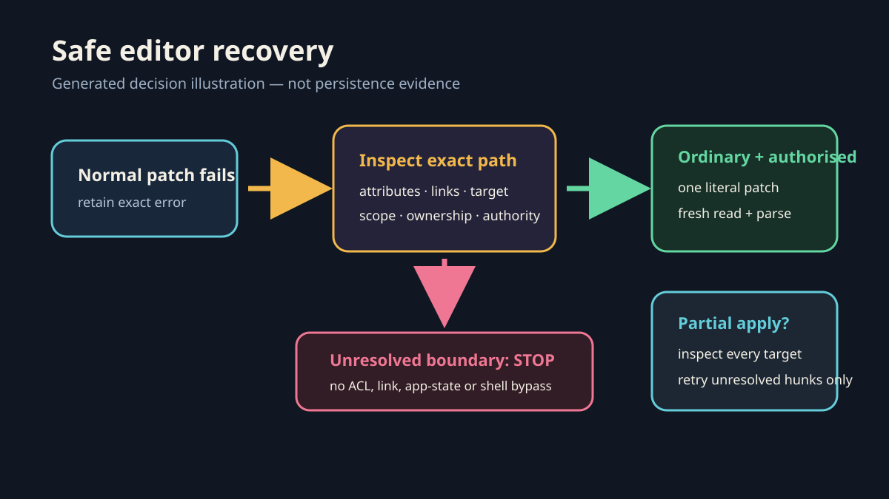

# Campaign safe-editor recovery

Recover a narrowly scoped project-file edit when the normal patch adapter rejects an ordinary writable path. This is a diagnostic and exact-write fallback, not a bypass for sandboxing, permissions, links, protected locations or public/account mutations.

*Generated decision illustration, not evidence that a filesystem path is ordinary or that a write succeeded. Actual attribute, approval, patch and readback evidence belongs in the private task report. A video adds no useful evidence for this static recovery path.*

## Establish the failure boundary

1. Read the exact destination and preserve unrelated changes. Record the normal patch error without diagnosing its cause from the wording alone.
2. Inspect the destination and each exact ancestor for attributes, link type and target. On Windows, use supported filesystem/reparse-point inspection plus current drive mappings when relevant.
3. If any link, junction, mount, denied read or unexpected target remains unresolved, stop. Do not remove it, change ACLs, move a workspace, alter application state or route around the boundary.
4. Run the owning project's temporary-directory create/write/read/atomic-rename/delete probe with the exact runtime and intended output parent before a multi-file, build or test operation.

## Apply one exact reviewed patch

Only after the user or environment has granted the required narrowly scoped escalation, resolve the currently installed patch engine through supported command discovery. Do not retain or reuse a versioned executable path from an older run. Pass one literal complete patch directly through the approved patch interface; do not substitute generic shell writes, batch wrappers or encoded commands.

Keep hunks in file order and scope them to the already authorised destinations. An escalation is permission for the reviewed operation, not blanket writable access. C-side application state, unrelated workspaces, external accounts and public mutations retain their own authority gates.

## Verify and recover partial application

The patch engine can apply earlier files before a later hunk fails. After every attempt:

- inspect every named destination before retrying;
- preserve successful files and adjust only the unresolved hunks;
- reread Markdown/text bytes and parse structured files;
- compare required rows, fields, order and hashes; and
- retain the exact error and approved recovery receipt.

A CSV byte-order mark or newline style can make a visually obvious header mismatch. Diagnose the bytes; do not discard the header, recreate the whole file or erase successful work. For insertions, anchor an exact stable non-header row when appropriate, retain every original record and re-import the result to verify schema and count.

## Potential problems

- A false reparse-point message is not proof of a filesystem defect. Record only that current supported inspection found no link at the checked paths.
- A wrapper that loses multiline patch bytes can fail while the direct supported patch interface succeeds. Preserve literal bytes and a final newline; do not weaken the patch.
- A successful exit is not persistence evidence. Require fresh reads and format-specific validation.
- Access denied in a different subtree is a separate boundary; this workflow does not authorise bypassing it.
- Do not restart Codex/ChatGPT, terminate helpers or edit application state as generic recovery.
