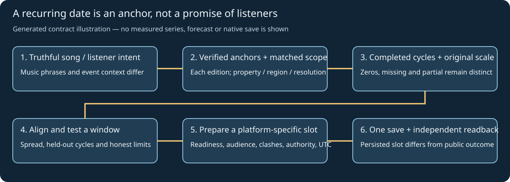

# Plan music discovery around recurring events

Use this workflow for a song that truthfully relates to a predictable annual, seasonal or recurring event. Turn historical keyword timing into an uncertain publication window, then combine it with the actual audience, platform and campaign constraints. A calendar association alone does not establish demand for the song or a useful hashtag.

Completion requires `Blogworthiness: PASS/FAIL`, the actual evidence and reason in the existing report. PASS also needs an angle, duplicate review and a concrete next state. Preserve the current run's ownership, active dates, no-op/stop/batch rules, approvals and cost limits. Keep agent coordination private; a saved guide or installation receipt is not proof of execution or adoption by another running job.



*Generated explanatory diagram, not measured search data, a native schedule or a forecast result. Real series charts and platform readbacks belong beside each campaign analysis. A recording or new promotional illustration of this static contract would add no implementation evidence.*

## 1. Start from the song, intended listener and action

Read canonical release/version/lyric authority, current keyword decisions and the exact planned media. Identify the intended audience, language, market, format and action: listen, watch, save or discuss. Keep release/artist navigation, song-theme/music phrases and broader event/context phrases in separate candidate families. A large event query may help choose a date while being a poor title or tag for a song.

Use source-native KeywordMoves discovery/imports, reviewed related searches and actual result context. Inspect whether terms mean music, news, shopping, finance, recipes, children's activities or something else. Keep term versus Topic identity, language, spelling and quote/operator semantics exact. Reject misleading titles, borrowed celebrity/brand navigation, current-news claims and unrelated event trends. Public copy should make the music/listening intent clear without stuffing. Natural phrases, hashtags, video tags and native topics remain separate fields under [the hashtag guide](hashtag-discovery-and-use.md).

Keep a broad-context cohort and a more specific music/listening cohort where a dominant term might hide low-interest series. Separate comparisons retain their own scales. Missing song-query measurements stay unavailable; they are not filled from an event curve. Preserve native related-query evidence that reveals mixed intent.

## 2. Verify each event anchor and recurrence rule

Build an event table before aligning the series. For every historical cycle and the proposed cycle retain: event/edition ID, official name, jurisdiction/audience, anchor date or interval, source URL, source observation date, event timezone, and fixed, movable or event-relative recurrence. Verify moved or newly announced dates again near the decision.

| Anchor type | Planning treatment |
| --- | --- |
| Fixed calendar date | Verify the target audience's relevant observance and each cycle's full date; align by that date rather than assuming equal week numbers. |
| Movable or announced event | Use the actual verified date of each edition. Do not overlay raw October/November dates when the event moved. Keep unlike editions separate unless the comparison rationale is explicit. |
| Event-relative date | Retain the named parent event, documented offset/rule and jurisdiction; resolve to an actual date for every cycle. A pre-event campaign phase can be distinct from event day. |
| Multi-day season | Record start/end and the chosen reference anchor. Assess lead-up, main event and tail separately rather than forcing all interest onto one day. |

Examples of families are Christmas shopping, Christmas dinner and a nationally announced Budget; these have different music intents and may peak at different times. A public holiday, cultural/religious observance, retail event and government statement are not interchangeable. Preserve regional differences and do not invent a universal celebration date.

## 3. Collect comparable completed cycles

Aim for at least **two usable completed cycles** when available, preferably more. One usable cycle is a dated reference, not established recurrence. Record unavailable/insufficient cycles and the exact reason. Never substitute zeros or silently extend a source window.

Freeze a collection plan with exact query/Topic identities and order, country/region, search property, category, language, event-relative lookback/lookahead, requested date range, observed sampling resolution, and original capture/export provenance. Comparisons require the same source metric/unit and matching relevant settings. Google Web, Google YouTube Search, native platform trends, owned referrals and third-party volumes stay separate evidence.

Retain the unmodified export or complete permitted native chart table, query/control state, date/source URL, hash, partial-period flags and any conversion ledger. An accessibility-table transcription must be labelled as converted native-table data, not as a downloaded CSV. Record the source timezone. Google's current FAQ distinguishes longer-range graph UTC from very short-range local time; do not silently treat a source date as the publication timezone. [Google Trends data FAQ](https://support.google.com/trends/answer/4365533).

Exclude incomplete current/future event windows from historical fits. Compare matching completed periods; a last partial week cannot be a trustworthy settled peak. Keep disruptions, structural breaks and event-name changes visible. Choose any exclusions before reviewing the desired outcome, with a source-backed rationale.

### Relative interest, zeros and resolution

Google Trends website indices are sampled, normalized relative interest, not absolute searches. A displayed zero may reflect low-volume filtering; an isolated small signal can be noise. Keep censored `<1`, zero, missing, insufficient and partial states distinct. [Google's explanation](https://support.google.com/trends/answer/4365533) and [normalisation tutorial](https://newsinitiative.withgoogle.com/resources/trainings/google-trends/basics-of-google-trends/).

Preserve a normalization-group/request ID. Never equate a 100 in independently requested years, average unmatched amplitudes or infer growth across differently scaled exports. Within-series re-scaling for shape comparison is an explicitly recorded transformation, not recovered volume. Do not join separately requested windows merely because they share a keyword. Any supported consistently scaled API requires its real access and its own documented unit, not an assumption about website exports.

Keep each observation's interval and native precision. A weekly/monthly point does not locate a daily peak; a daily point does not locate an hour. Do not upsample or interpolate a narrow peak without saying what is assumed. If the source cannot resolve the decision window, retain a broader interval or a precision hold.

## 4. Align cycles, summarise windows and test the rule

Use the verified event as offset zero in each cycle. Retain the original dates and interval endpoints alongside event-relative offsets, including bins that straddle the event. Keep pre-event rise, highest-interest interval/plateau and post-event decline separate. Ties are a plateau or multiple candidate intervals, not a reason to choose the most convenient single day.

Declare the selection rule before using it: lookback/lookahead, eligible observations, any smoothing, treatment of ties/censoring and any relative-to-cycle peak threshold. Do not search many rules until one supports a preferred slot. Publish the rule, source hashes and actual tool version with the result. A threshold, smoothing width or confidence label is an analyst/model choice, not a platform recommendation.

Report per-cycle peak intervals and onset/tail evidence, usable-cycle count, observed offset spread, candidate future window and confidence rationale. Distinguish historical min/max or interquartile spread from a calibrated prediction interval. Two matching peaks can support limited calendar context while leaving music demand and future repeatability uncertain. Failed, diffuse, censored or mixed-intent evidence lowers confidence; use a precise hold when no useful window is supported. Do not collapse unlike event and music series into a universal score.

When at least three useful cycles permit it, hold out the latest completed cycle and form the window using earlier cycles only. With more cycles, use rolling-origin or expanding-window checks matching the intended forecast horizon. Evaluate whether the held-out peak interval was covered, signed/absolute offset error and the width of the proposed window; a year-wide band is not a useful success. Declare training/holdout cycles and failures. With too few cycles record `backtest_unavailable` or `descriptive_only`; an in-sample fit is not a successful forecast. This temporal-order requirement follows [Hyndman and Athanasopoulos's cross-validation guidance](https://otexts.com/fpp3/tscv.html).

## 5. Use the actual maintained-tool contract

Confirm the latest released KeywordMoves version and the runtime actually imported before selecting commands. Use its current Google Trends normalization/import route for the retained source and preserve JSON outputs. A normalized import does not itself perform event alignment, backtesting or publication planning. Read the selected module guide and record which of those operations actually ran.

For a missing reusable analysis capability, implement and test the smallest owning-tool operation, documentation and synthetic example before claiming it exists. Retain current source/tested/released/installed identities separately. Do not use a hand-written per-campaign forecasting engine, invent a command or describe this guide as a statistical validator. A new local keyword hypothesis enters the canonical evidence register as proposed through its guarded workflow; forecast confidence does not grant public-copy adoption.

### Version-gated KeywordMoves event-cycle route

For KeywordMoves **0.6.2 or later**, use the released [event-cycle contract](https://github.com/kieransimkin/KeywordMoves/blob/main/docs/event-cycles.md), verifying its identity against the runtime actually imported. Earlier versions' normalization/import operations do not provide this planner. A guide that names a minimum version does not establish that it is released or installed on this machine.

```powershell
keywordmoves run google-trends --operation plan-event-cycles --input event-manifest.json --input cycle-a.csv --input cycle-b.csv --input cycle-c.csv
```

The first input is `keywordmoves-event-cycle-plan/v1`; subsequent inputs are the exact retained CSV bytes, not inline keyword seeds. Bind `subject`, `planned_at`, verified next event, exact `scope`, event-relative `window`, per-source CSV index/hash/observation/event date/reference and explicit phrase `reviews`. The scope includes geography, search property, category, query kind and temporal basis. Use the owning guide's complete schema and bounds; source labels and a valid manifest alone do not prove those assertions. Optional preferred-source mappings resolve multiple captures of the same phrase/event without counting them as extra cycles.

Retain the complete result JSON, including `metadata.policy` and each candidate's `metadata.event_profile`: source quality and exclusions, independent usable events, forecast intervals, chronological whole-cycle holdouts, timing support, source-selection issues and any proposal. The fixed quality thresholds and high-interest rule are exposed heuristics; record them with the version. A sparse or jointly suppressed term can abstain even if a broad event term has a clear peak. Original `<1` censors remain distinct from zeros; re-scaling cannot restore resolution lost in a shared comparison.

Optional `scheduling` declares platform, timezone, editorial `lead_days`, allowed date boundaries and blocked dates. Its proposal is a date window only: `optimal_hour=null`, `music_demand_validated=false` and `implementation_authorised=false` remain explicit. It saves nothing. Two usable cycles remain limited; failed held-out timing, unvalidated intent or insufficient quality can withhold a proposal. Run the shipped synthetic example as a contract check, label it synthetic and apply the real retained sources separately. A successful synthetic example does not validate a campaign forecast or native schedule.

## 6. Turn the demand window into platform-specific candidates

Start with the supported **window**, not a supposedly optimal minute. Combine it with the actual public-eligibility/release boundary, media/cover/caption readiness, measured or currently observed processing/check duration, native search/discovery evidence, account audience activity and nearby campaign slots. Record each component's source and uncertainty.

Upload/processing readiness and publication are separate. YouTube documents that higher-quality processing depends on format, length, frame rate, quality and traffic; use actual readiness and a defensible operational buffer, not a universal upload lead. [YouTube processing guidance](https://support.google.com/youtube/answer/71674). Search indexing/discovery lead is a separate, often unavailable measurement; no fixed buffer guarantees indexing or reach. Native account activity may help select an hour inside the window, but daily Trends data alone cannot do so. If hour evidence is absent, retain an adequate existing hour or make a clearly labelled operational choice.

Inspect all relevant native queues/calendars for the actual account, format, competing releases and audience fatigue. Keep full films and individual Shorts distinct. Do not create extra posts, change media quality, add spend or force simultaneous cross-platform times merely to exploit a peak. Begin applicable YouTube and TikTok routes, with each platform's own controls and evidence. Later/earlier lead content must keep “out now”, relative dates, event tense and links truthful at its actual proposed time.

Record the original slot, proposed local start/end or chosen slot, IANA timezone, explicit offset/UTC, evidence-backed reason, unchanged and changed fields, relevant user authority and expected trade-off. Use a named zone across daylight-saving transitions; reject nonexistent times and disambiguate repeated times with UTC. The historical data's timezone and the native publication zone must both remain explicit.

A native city/current-timezone label alone is insufficient across daylight saving. Retain the explicitly displayed offset, entered wallclock/zone and the future UTC instant; independently round-trip the reopened native candidate and saved queue against the intended IANA-zone time. A native interface may retain its current offset for a future date. A supported fixed-offset control can express the reviewed instant only when that conversion and the independent persisted readback agree; do not claim that a displayed city label proves the future offset. If the instant cannot be established, retain a precise schedule hold rather than guessing a one-hour correction.

## 7. Preserve authority and commit an authorised schedule once

A forecast and this workflow do not themselves authorise an external action. Apply the latest direct user instruction to its actual scope: an explicit request to optimise/reschedule relevant upcoming posts can supersede their earlier dates; it does not move unrelated posts, distributor release dates, rights, embargoes or automation definitions. Preserve earlier explicit dates outside that scope. Do not re-ask for general permission already granted; retain the authority-to-item mapping and the concrete reviewed before/after proposal.

Already public media is not rescheduled by deleting/reuploading it. An unsupported editor/scheduler or unresolved pending save is a hold. Future scheduling remains the default unless immediate publication was explicitly requested for that item. Follow [direct scheduling](direct-social-scheduling.md) and [release-video scheduling](release-video-social-scheduling.md):

1. Freshly identify the account/native item, current complete copy, media/cover/labels/settings and original persisted slot. Resolve source drift and other-owner/pending actions before mutation.
2. Review the exact new time and any necessary relative-date/copy correction. Refresh source/native context, payload/approval and hashtag/native-metadata checks against the actual committing date. Far-future items retain a named prepublication recheck in the existing continuation queue, without creating an extra automation. A text-only audit does not verify schedule, media or settings.
3. Read back the intended local date/time/timezone and explicit UTC, complete changed copy and preserved fields in the supported native control. Save the intended change once. Do not publish immediately or cancel/recreate an item to bypass a missing reschedule control.
4. Independently reopen/reload the native queue/item. Require the same account/object, accepted fields and exact new slot/timezone/UTC, plus preserved media/cover/labels/privacy. A toast, local plan or calendar entry is not native persistence. Keep an ambiguous save pending and inspect it before any retry.
5. Reconcile current campaign plans, local calendar/copy/generator inputs and action records with the verified native result; retain original slots and receipts as history. Do not overwrite an existing source calendar merely to make it agree with a proposal. Later verify actual public state/playback and perform eligible same-job EPK media reconciliation through its own gate.

YouTube's current guide describes date/time/timezone scheduling and supported changes; inspect the actual item's controls rather than assuming every platform or already-public object can do the same. [YouTube scheduling](https://support.google.com/youtube/answer/1270709).

## 8. Learn from actual outcomes and finish the handoff

Keep forecast validation separate from campaign performance. Retain forecast/run/source/copy/media/item IDs, original and accepted publication times and comparable reporting windows. In the existing cadence, review actual search/referral exposure, qualified watch/completion, meaningful saves/shares and listener/link actions where available. Compare same-platform/account/format and comparable post ages; preserve unavailable values, denominators and settled-window limits.

Timing, copy, creative, audio, competition, audience growth and spend can all change. Record those confounders; an uncontrolled seasonal before/after is descriptive, not proof that timing or a hashtag caused uplift. Do not manufacture duplicate uploads or new automations for a test. Keep neutral/failed results and update the next cycle's assumptions rather than treating one spike as a permanent rule.

Minimum retained record: exact song/version/asset and listener intent; chosen/rejected event/keyword families; official per-cycle anchors and sources; original exports/captures/hashes and scope/resolution/normalization; complete/excluded cycles; frozen rule/tool identity; per-cycle windows, spread/confidence and holdout results/limits; per-platform lead/activity/clash evidence; original/proposed/accepted slots with timezone/UTC; authority and payload/copy hashes; native receipt and later public outcome; review metrics/confounders; next action; mandatory blogworthiness assessment. Keep private account/rights material out of portable repositories and public stories.

## Potential problems

- **A movable event changed date:** align each verified edition; raw calendar overlays can invent a lead or lag.
- **A contextual query overwhelms music terms:** keep a separate music cohort and inspect related-result intent; zero/insufficient still does not mean absent listeners.
- **Only one or two useful cycles exist:** retain limited/descriptive evidence and the unavailable backtest; do not label a narrow window statistically proven.
- **A wide source bin is plotted as a day:** preserve interval precision and widen/hold the decision; no optimal hour from daily series.
- **A search property, Topic, region or normalization group changed:** keep separate comparisons or recollect an authorised matching source; never silently join amplitudes.
- **The proposed slot crosses release/embargo or daylight saving:** resolve exact eligibility/copy and zone/UTC before action; do not alter the release date to rescue a forecast.
- **The native schedule differs after saving:** retain the discrepancy/pending state and resolve the existing item; a plan is not a receipt.
- **A guide was installed but no analysis ran:** report configuration only. A command exit, source import or chart alone does not establish a forecast, native schedule or improved reach.

Primary method/control references checked 24 October 2026 are linked beside the relevant claims. The two-cycle minimum, confidence treatment and planning record are conservative workflow choices; they are not Google or platform rules.
