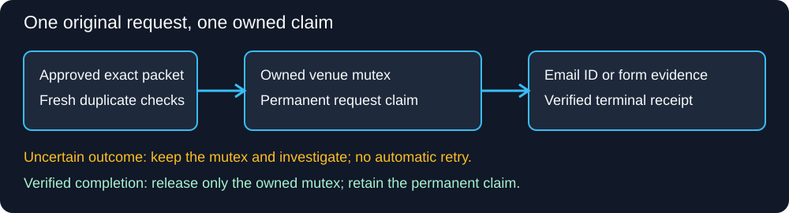

# Coordinate duplicate-safe outreach

Use the standard-library CLI when several cooperating workers might answer the same request or submit to the same venue. The gate does not send, grant approval, read email or verify a website. Supply a persistent private claim directory outside source control.



Generated contract illustration for WorkflowMoves 0.1.35; not a screenshot or evidence of delivery. Synthetic test fixtures demonstrate the state transitions. No real correspondence or web screenshots belong in this public example. A demonstration video adds no useful evidence to the static receipt schema.

## Claim and verify

Read the shared record, resolve the canonical venue and earliest original request, and review the exact packet and approval. A different payload, address or split thread does not create a new unanswered obligation. Then claim:

```sh
python -B tools/outreach_send_gate.py --root /private/send-claims claim --account artist@example.invalid --venue canonical-venue --obligation original-request-id --owner unique-worker-id --packet /private/approved-packet.json --approval exact-approval-reference
```

Retain the returned key and token privately. Recheck the full current thread, independent Sent or native submission evidence and intentional archives after claiming. Inspect the owned claim immediately before the separately authorised action. A claim verifies ownership and packet bytes, not prior transmission or recipient acceptance.

```sh
python -B tools/outreach_send_gate.py --root /private/send-claims inspect --key KEY --token TOKEN
python -B tools/outreach_send_gate.py --root /private/send-claims finish --key KEY --token TOKEN --receipt /private/verified-receipt.json
```

## Retain the right receipt

- Email transmission: `state: sent_verified` with a genuine persisted `message_id`.
- Final email failure: `state: final_failure` with a genuine persisted `message_id`.
- No action occurred: `state: aborted_before_send`.
- Web form: `state: submission_verified`, `destination_url`, `success_observed`, and a nonempty `evidence_files` list containing exact local `path` and `sha256` pairs. Each file must exist and match its SHA-256. Do not fabricate an email or provider ID.

A native success message plus retained screenshot/state can support a form receipt; a spinner, cleared fields alone or a click cannot. Neither an email Sent label nor form success proves delivery, reading, acceptance or a subsequent public outcome. The helper checks local evidence identity, not its truth.

Only an owned mutex with an eligible verified receipt can finish. The permanent original-request claim remains, preventing a second send. Uncertain outcomes, owner mismatches, changed packets and altered evidence fail closed. There is no automatic lock expiry or takeover. The helper serializes cooperating callers only; it cannot guarantee adoption or email-provider exactly-once behaviour.

## Potential problems

### A form has no email message ID

Use the verified form schema and exact retained evidence hashes. Synthetic tests cover completion without an invented ID and rejection of missing success, empty evidence and a changed hash. Keep the message-ID requirement for email receipts.

### Temporary test directories are unavailable

The tests create isolated fixtures beneath the test directory. Run them in an authorised writable checkout; do not change account permissions or weaken security to make a fixture pass. An environment failure is not a passing test.
