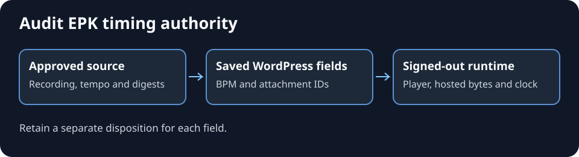

# Audit EPK timing authority

Use this read-only workflow for a release or catalogue. Compare the authority for the exact recording with saved WordPress selections and what an anonymous visitor receives. The [EPK REST publishing guide](wordpress-epk-rest-publishing.md) handles a separately authorised repair.

*Generated diagram. The example states below are synthetic and contain no editor data or unreleased lyrics.*

## Identify and compare

1. Identify the intended releases, exact masters or approved derivatives, page IDs and publication statuses. Keep related press, draft and companion pages separate. Retain inaccessible entries within the stated audit scope.
2. Resolve authority per field from the current release provenance, asset manifest, detailed approval and explicit artist locks. Record the BPM basis and accepted lyric and cue digests. An approved file can have a nonstandard name. Resolve its path inside the release folder and verify the digest, recording and approved revision. Check detailed provenance when a registry summary gives a different status.
3. Read saved BPM and lyric/cue attachment IDs using authenticated, documented REST reads. Separately record the public page configuration, player, source clock, BPM and timing URLs. WordPress-selected EPK Timing attachments govern the runtime. Report a page-local override as a conflict.
4. Fetch the exact public attachment bytes without the editor session. Verify UTF-8, hash, parseable events and timestamps against the verified recording's bounds. Retain documented exceptions such as an approved end marker. If only the authenticated fetch works, the public check is inaccessible.
5. Record authority, saved fields, anonymous configuration, hosted bytes and parsing separately. If testing a consumer, verify actual playback and source-clock progress. Retain any attended listening review separately from structural checks.

| Synthetic observation | Disposition |
| --- | --- |
| An approved file with a nonstandard name matches the recording, digest, editor and runtime. | Confirmed match |
| A summary says accepted while detailed provenance still requires listening approval. | Provisional authority |
| The selected digest differs from approval or the anonymous runtime uses another attachment. | Conflict |
| The track varies in tempo and lacks an approved single BPM. | Single BPM held |
| The source is absent from reviewed records or a host request fails. | Missing within scope or inaccessible, respectively |

Retain per-field counts and evidence. For a proposed correction, keep the exact outstanding source or approval requirement. Keep timing files and private authority records in the owning project.

## Potential problems

- **A newer file looks more complete.** Verify its authority and recording before changing the disposition.
- **An older approved digest differs from live.** Check for an explicitly approved compatibility derivative and retain both identities.
- **Metadata matches and the display stays empty.** Check the served runtime, player association, file request, parser and clock independently.
