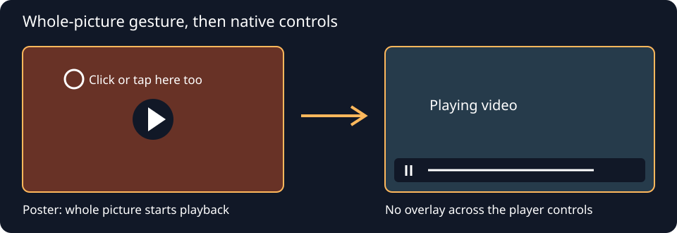

# Whole-picture video playback

The visible video picture is a play target. A visitor can click or tap away from
the central Play button to start; an already playing native video can be paused
the same way. Keep an accessible keyboard Play control and the provider's own
mute, seek, fullscreen and pause controls.



*Generated contract diagram, not a screenshot or proof of playback.*

Prepare a narrow repair from fresh saved editor bytes:

```sh
python tools/repair_epk_video_surface.py fresh-page.html --profile profile.json --output candidate.html --receipt repair.json
```

The explicit profile supports `cover: true`, `native_sources: ["https://…"]`
and `provider_starts: [{"id": "VIDEO_ID_11", "poster": "https://…"}]`. It never
infers a media association, poster or soundtrack offset and never publishes.
Native URLs must already belong to controlled videos in the source. Provider
IDs must match exactly one existing YouTube embed; its iframe stays byte for
byte intact inside the inert template. The poster fills the original frame.
Only the user gesture creates the autoplay-enabled iframe; the poster and Play
control then clear its controls. No invisible overlay remains over playback.

Existing artwork covers retain their current style and geometry. Their sole
runtime gains whole-picture activation and a narrow pointer hit-area rule.
Return to artwork removes the iframe and restores keyboard focus. Existing
reveal/close events retain ownership in the shared DanceMoves playback binding.
The helper does not replace audio, timing attachments, master associations,
lyrics, choreography, metadata or other videos.

Native enhancement uses an explicit URL allowlist and native media controls.
Touch taps reject movement beyond eight CSS pixels, cancellation and a hold
longer than 650 ms. A compatibility click cannot toggle twice. Pointer movement
is never cancelled, so scrolling remains available. Pagehide tears down native
listeners; pageshow mounts once. Native controls consume their own events;
do not invent a control-strip height or cover them with a click-catching layer.

The receipt records exact source/candidate hashes and named edits. The reverse
proof must restore every original UTF-8 byte, including CRLF and Unicode. This
does not prove rendering, transport or playback. Preserve the normal fresh-source
ownership, exact-candidate approval and public-save gates.

## Verification and potential problems

Preview before saving at desktop, tablet and phone widths. Actually click and
tap off-centre, then verify advancing decoded media, pause, keyboard operation,
close/reopen, mute, seeking, fullscreen and phone scrolling. Check poster/reveal
bounds, surrounding appearance and the retained source clock. Keep screenshots
and, for a dynamic demonstration, a short actual recording in the private task
evidence. A revealed iframe, HTTP response or synthetic event alone is no
playback pass. Provider age, geographic, consent and embedding failures remain
separate availability states.

For 3D artwork, inspect the actual hit target after pointer movement. A tilted
child may fall behind a parent's preserve-3d hit plane. Resolve only that page's
stacking context and compare its visual effect; do not disable motion across
the catalogue or infer an engine-wide problem.

WordPress can turn entity-sensitive inline operators into entities even when
saved source readback matches. The emitted runtimes are one physical line with
no less-than or ampersand tokens. After saving, inspect the rendered script,
parse it and repeat real picture gestures on the ordinary public URL. Source
readback and response-substituted previews are distinct evidence states.
