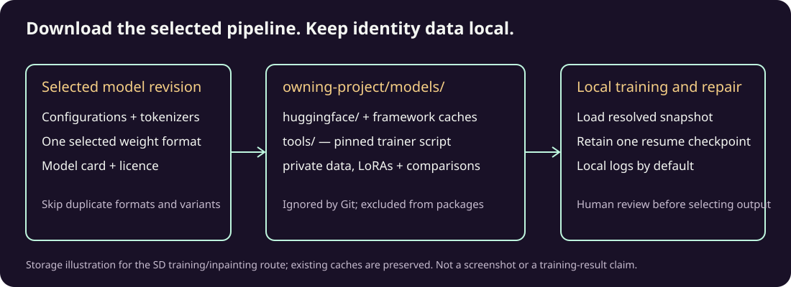

# LikenessForge image preparation in DanceFlow

[DanceFlow](https://kieransimkin.co.uk/danceflow/) · [LikenessForge source and current commands](https://github.com/kieransimkin/LikenessForge)

Use LikenessForge when an existing composition is suitable but an authorised person's facial likeness needs repair, or when authorised references need face-focused preparation and identity LoRA training. It prepares still-image candidates; it does not identify people, certify likeness or grant publication rights.

## Choose and record the inputs

Inspect the actual source image and approved identity references. Preserve canonical artwork and original photographs unchanged. Record private paths, hashes, intended use and approval state. Keep portraits, trained identity weights, debug traces and rights evidence out of public repositories and releases. Permission to prepare an image is not permission to publish it.

Inspect `likenessforge plugins`, `models list` and the selected plugin documentation. Choose detector, segmenter, modifier and trainer explicitly; record model revisions when available, LoRA architecture, settings, seed and hardware. Pair compatible trainer/modifier families. First use may download models and helper scripts; respect resource scope, licence and model terms. Low-VRAM modes depend on the actual GPU/runtime and workload.

## Prepare and review a repair

Inspect the numbered output from `faces` before choosing a face index or `largest`. Use `repair` for a known recipe or `repair-wizard` for a bounded comparison. Review face and full-image comparison sheets against inspected references: likeness, expression, lighting, blend boundaries, other people, unchanged composition, text, crop, alpha and phone-size use. Keep every original, candidate and rejection distinct; select only after human review. Completion or a comparison sheet is not approval or a quality guarantee.

For training, inspect `prepare-training` crops before `train-lora` or `train-wizard`. Keep a validation photograph outside the training set. Compare variants with the same holdout and repair settings. Retain training manifest, plugin/model/LoRA identities, settings, seeds and hashes. Synthetic/offscreen tests establish orchestration, not actual GPU fit or likeness quality.

## Hand the selected asset to the next tool

Keep the selected still and its lineage as an explicit file handoff. Use RasterMoves for applicable upscaling/refinement, PixelCue for optional media tagging and ThumbMoves for cached thumbnails; none certifies identity or public-use rights. Every derivative gets its own hash and review. DanceMoves owns subsequent web motion and lifecycle/accessibility; LikenessForge adds no clock, sensor or page runtime. No automatic bridge or MCP repair/training adapter is implied.

For campaign/EPK use, retain the selected candidate beside canonical references, assess visual coherence, verify alpha/crop and transformed bounds, then follow destination approval, scheduling, metadata, responsive and playback checks. Generated portraits remain artist-authored promotional assets, not independent publicity. Record prepared, approved, uploaded, scheduled and verified-public states separately. Never silently replace unchanged canonical artwork with a repaired derivative.

## Installed profiles and project-local models

*Maintained LikenessForge 0.4.5 storage illustration, copied under its MIT licence; SHA-256 `13efccc6a269ca749a7af314d09d963f00c3a6b7fd62fbbbe4b9068ab81c0542`. It is not evidence of a completed run. Actual setup/training screenshots and comparisons belong with the private run record; a video adds no useful evidence for static configuration alone.*

Verify the installed runtime through its maintained launcher, current-runtime record and imported package identity; a versioned environment directory can outlive an upgrade. A private artist adapter may fill native GUI fields but must not become another processing engine.

Resolve the owning project first. Route downloaded weights, framework/model caches, training data, LoRAs and private traces beneath that project's ignored `models/`. Retain selected model revisions/licences, upstream checksum manifests, actual file hashes, reviewed crops and holdout evidence. Do not silently move/delete existing models or download unrelated families to satisfy an inventory.

Use the shared model-backed plugin preparation route in LikenessForge 0.4.5 or later: GUI setup, CLI model download and runtime share selective acquisition. Selection receipts establish local cache availability by file presence and size; they do not establish upstream freshness, GPU loading, likeness quality or approval. Automatic device selection may need another precision variant when hardware changes.

## Potential problems

- **Downloaded diffusion models appear missing:** older generic Hub snapshot probes may require unrelated exports. Use current selective plugin readiness; do not download an entire repository merely to change status.
- **Trainer rejects startup arguments:** use the adapter matching its pinned official trainer. Put cache paths in the subprocess environment when that trainer exposes no cache argument; preserve the resolved model identity.
- **Very slow Windows Torch metadata discovery:** inspect the maintained `scripts/prepare_windows_runtime.py` helper from the installed release source and apply it only to the intended environment. Metadata repair is distinct from model loading.
- **Large camera images produce missed faces:** bounded detector inference must map detections back to original coordinates. Review numbered detections and actual crops before training; never infer the intended person from a filename.
