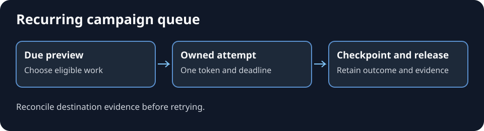

# Run a recurring campaign queue

Use this guide when one scheduled carrier runs several independently approved campaign profiles. The queue determines what is due and who owns the attempt. Each profile and destination determines which actions can proceed. Use [direct social scheduling](direct-social-scheduling.md) for native post slots and [the duplicate-send gate](duplicate-send-gate.md) for external replies or submissions.

*Generated process illustration. The acceptance cases use synthetic profiles. The real scheduler and campaign records contain private job details.*

## Select and claim

1. Read the current project instructions and queue manifest. Resolve the named timezone and due time. Keep recurring phases, one-time windows, paused profiles and non-date stop conditions distinct. Preserve each profile's original cadence, instruction source and approval scope.
2. Preview due work without mutation. End quietly when no work is due. If a required shared resource is leased by another job, leave eligible work pending.
3. Claim eligible work atomically. Bind owner, token, selected occurrences and deadline. Verify each selected instruction file against its recorded digest before acting. A mismatch holds that profile. Respect the configured time, batch and concurrency limits.
4. Read the latest canonical campaign state and same-date record. Reuse fresh shared evidence only where its original scope fits. Keep campaign-specific approvals, rights and publication gates.

## Reconcile the obligation before acting

Join older due records to later canonical decisions, original receipts and current destination state using the underlying obligation and destination identity. For example, an approved replacement track can supersede an earlier submission task. Preserve both decisions. An open form with a verified same-ID success receipt is already fulfilled. If the receipt and destination disagree, hold the action until the result is known.

Record the actual state, such as fulfilled, superseded, expired, pending verification, awaiting approval or unavailable. Continue unrelated eligible work. Apply the destination's current approval and duplicate checks immediately before an external mutation.

## Checkpoint and release

Record each attempted occurrence under the owning token. Link actual evidence and distinguish completed, partial, blocked and no-action outcomes. Advance the cursor under the queue's completion rules. Keep partial occurrences pending with a bounded retry and fairness policy. Mark deferred work separately when the deadline prevents starting it. Reconcile uncertain sends, saves and uploads before retrying.

Finalize the batch and release the owned lease even when time runs out. Recover a lease only after verifying the exact owner is stopped or idle through a supported status check. Reconcile already persisted checkpoints before resuming. Record [blogworthiness](blogworthiness-completion.md) in the usual report.

## Acceptance and potential problems

- **Two workers see the same due item.** Prove one atomic claim succeeds and a different token cannot record or release it.
- **The worker stops after saving a checkpoint.** Recover the checkpoint with exact owner evidence. A lease's age alone never clears ownership.
- **Local time or phase changes.** Test a daylight-saving transition, a paused profile and an expired one-time phase. Verify fair retry after a partial attempt.
- **An outdated task recurs.** Test a superseded task and a still-visible form with a prior verified success receipt. Neither should create a duplicate submission.

Test with disposable profiles and a local lease store. A configured scheduler, successful claim or checkpoint establishes its own stage. Verify real campaign outcomes separately.
