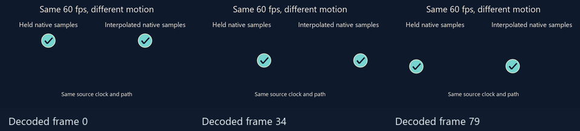

# Diagnose jerky motion in rendered video

Use this when a technically valid render still looks stepped, jittery,
flickery or smeared. Compare the exact encoded file with the expected
movement. Keep the authorised audio, cue timing and delivery rate fixed
through a comparison.

## Find where the motion changes

1. Verify decoded frame count and presentation timestamps with
   [encoded-video verification](rendered-video-verification.md). Play the
   affected passage at normal speed and step adjacent decoded frames.
   Mark a fast passage, a reversal and a cue or loop boundary where relevant.
2. Follow one affected object. Compare its decoded position, rotation or
   atlas cell to its source-time transform or a clean composition checkpoint.
   Use a region or named layer to isolate it. A changing background can mask
   repeated poses, and H.264 can change pixels around a stationary sprite.
   Record frame number, source seconds and the expected beat phase.
3. Identify where the change first appears. If the source pose already
   jumps, inspect the motion clock and inputs. If the pre-effect pose is
   smooth, compare the post-effect checkpoint and final decode. Check the
   relevant layer's feedback, sampling, alpha and extent.

## Choose a targeted correction

| Finding | Correction and proof |
| --- | --- |
| A procedural position repeats across output frames. | Inspect the source beat, motion rate, fractional pips and transform precision. Audition adjacent native-pip interpolation for named, table or matched motion when appropriate. Record the actual setting. FrameRudiments temporal supersampling can enable this interpolation when unspecified. An explicitly held atlas or bounded recording keeps its own sampling contract. |
| A continuous path moves too far between frames. | Audition the trajectory period, excursion or rotation with the same beat anchors. Check the direction, endpoints and phase. Where the approved range matters, preserve that range and vary the rate or conditioning first. |
| The path is smooth but a moving sprite looks harsh. | Audition scoped directional blur or a trailing afterglow at the element. Align the direction with the trajectory, taper the streak as speed approaches zero and check the union of transformed sprite bounds. Inspect reversals for ghosts and edges for dark fringes or clipping. |
| Captions or the background smear with the sprite. | Inspect effect scope. Source-time supersampling evaluates multiple times inside an output frame. Directional blur samples translations of an element, and a temporal shutter combines earlier composed states. Use element scope where only one object should streak. Check caption onsets, lyric clears and adjacent scene changes with the chosen shutter. |
| Only the feedback output flickers. | Audit preset changes, effect parameter excursions, routing and warm-up. FrameRudiments runs GPU feedback once per output frame after source-time blending. Compare a sequential sample with the same history. [Check the actual effect stages](rendered-video-verification.md#prove-visualiser-routing-in-the-encoded-output). |

Change one family at a time on the same source interval, with the same
crop, codec and playback speed. For borrowed footage or a low-rate atlas,
record its native motion cadence and any duplication or interpolation.
The output frame rate and the cadence of the input motion describe
different things. Keep the selected treatment tied to its encoded preview
and report the actual release-quality sample when one is needed.

[FrameRudiments quality effects](https://github.com/kieransimkin/FrameRudiments/blob/v0.4.29/docs/quality-effects.md)
and [source-time supersampling](https://github.com/kieransimkin/FrameRudiments/blob/v0.4.29/docs/spatiotemporal-supersampling.md)
describe the supported fields and sampling order.

## Compare the same native motion at 60 fps

[Play the two-second 60 fps comparison](media/render-motion-comparison.mp4).
Both sprites use the same DanceRudiments path, beat clock, scale and output
cadence. The left holds the native integer-pip pose and the right samples
between adjacent native pips. On this synthetic render, the sprite centroid
moved less than 0.75 pixels in 56 of 119 adjacent pairs on the left and
zero on the right. The clip passed full decode and CFR verification. These
measurements describe this fixture. Check real-song motion by watching the
relevant passage and its boundaries.
[Verification receipt](media/render-motion-comparison.json) · [Reproduction source](https://github.com/kieransimkin/WorkflowMoves/blob/main/examples/render-motion-comparison.py)

## Potential problems

- **Every decoded frame has a different hash but a sprite visibly holds.**
  Track the sprite pose or a segmented region. Encoder variation and
  independent background motion can change a whole-frame hash.
- **The motion improves in the clean stills and flickers in playback.**
  Compare sequential encoded clips across the same lead-in and event.
  Document whether the fault first appears in feedback, compositing or the
  decoded file.
