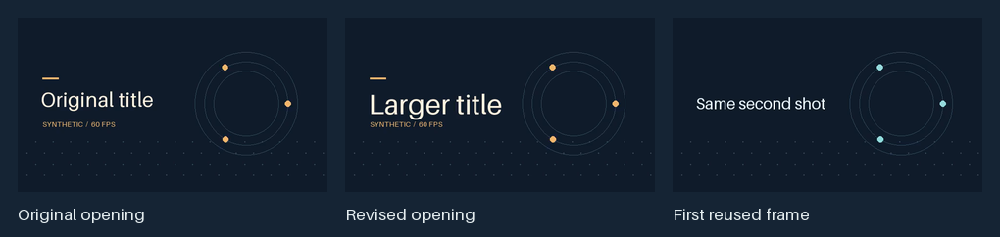

# Revise a rendered music video

Use this when a review changes a title, lyric layout, effect or passage of an
existing render. Keep the original project, media, timing and rendered files as
the baseline. Record the requested change, the approved parameters it inherits
and the first and last affected source/output frames. Include entrances,
transitions, temporal sampling and any effect history that carries the change
past the edited interval.

## Audition the change

Check the proposed change with the smallest proof that can demonstrate it.
Compare the same source frames and project settings. Use composition stills
for isolated type, framing or alpha edges. For a feedback, flicker, shutter or
music-timed change, encode a short sequential sample with the required lead-in
and original audio mapping. Label any composition-only sample that skips
feedback history. Test authored changes at the final aspect ratio and check
painted bounds, including stroke and shadow, at phone size. If the edit changes
the soundtrack cut, recheck the exact sample bounds, vocal tails and repeated
seam in the encoded preview.

For warped graphics over a new background, inspect branch alpha and composite
the result over the intended plate. Use the released transparent-border or
matte route when it fits the effect. If a flattened legacy effect supplies
opaque edge fill, constrain any correction to the affected branch and verify
that intentional dark detail survives. Compare the decoded frame before,
during and after the transition.
[FrameRudiments spatial warps and border modes](https://github.com/kieransimkin/FrameRudiments/blob/v0.4.28/docs/effect-graph-m7-3-spatial-warps.md)

## Choose how much to render

| Change | Render and verification scope |
| --- | --- |
| A cue or layer changes subsequent feedback, or a temporal window crosses the edit. | Find the earliest affected frame. Keep finalized frames before that boundary only when their exact inputs and temporal coverage still match. Restore history by replaying from frame zero and re-encode the affected suffix. Resume only if the native plan and input checks accept the retained prefix. A changed project requires a new revision. |
| A picture-only edit ends before an independently decodable join and leaves the later composition and clock intact. | A bounded replacement may preserve the verified later video and the exact soundtrack. Rehearse the splice with the chosen encoder and stream format, and verify the conditions below. |
| Timing, soundtrack or render settings change, or the boundary cannot be proved. | Recompose the affected state from its earliest dependency. Use a fresh render for the full deliverable when continuity or stream compatibility is unresolved. |

Record the source manifest, expected changed interval, render estimate and
ownership decision. Use the existing [render ownership and storage rules](framerudiments-rendering.md#choose-foreground-or-operating-system-render-ownership).
An incomplete parent can yield a separate work-in-progress preview when its
contiguous finalized chunks and matching audio interval are available. Read
finalized chunks only, verify the excerpt and name its coverage. Keep the
live worker's output and its ownership intact.

## Verify a bounded splice

1. Pin the verified parent MP4 and its render manifest. Confirm that the
   replacement and copied material have compatible stream parameters, the
   same output grid, the expected number of frames and a closed, independently
   decodable boundary at the intended frame. A seek time or keyframe flag
   alone leaves reference frames and the actual first decoded picture open.
2. Keep the replacement, copied parts and assembled revision in their own
   output folder. Use the matching FrameRudiments assembly contract and the
   original programme exactly once. When the edit is picture-only and exact
   audio reuse is part of the contract, compare the audio packet payloads,
   timeline and decoded sample count/digest with the verified parent.
3. Compare the decoded frames on both sides of each join with their intended
   sources. When claiming an unchanged video suffix, verify the reused packet
   payloads or the complete decoded suffix against the parent on the same
   frame grid. Check all-frame CFR, full A/V decode and the final hash.
   Re-render from a compatible boundary if the rehearsal or final proof
   disagrees. Follow [encoded video verification](rendered-video-verification.md)
   for the attended and delivery checks.

*Actual decoded synthetic proof at 60 fps. The 240-frame revision preserved
all 120 decoded frames after the splice, 189 audio packet payloads and
timestamps, and all 192,000 decoded stereo sample frames.*
[Play the synthetic revision](media/video-revision-demo.mp4)

## Potential problems

- **A sample omits the flicker that appears in the film.** Compare real
  sequential playback with the needed temporal warm-up. Inspect whether
  feedback, a fast parameter excursion or an encoder artifact causes the
  change before altering the effect.
- **The replacement and tail both decode, but the join drifts.** Compare the
  decoded grid and verify the first copied picture and audio mapping. Use
  the native frame-grid assembly fix for the documented timestamp-rounding
  failure. Recompose when the stream dependencies are incompatible.
- **A narrow revision loses an earlier creative decision.** Compare the
  candidate with the cumulative brief and project inputs, then check the
  same unaffected frames and the relevant audio interval before delivery.
