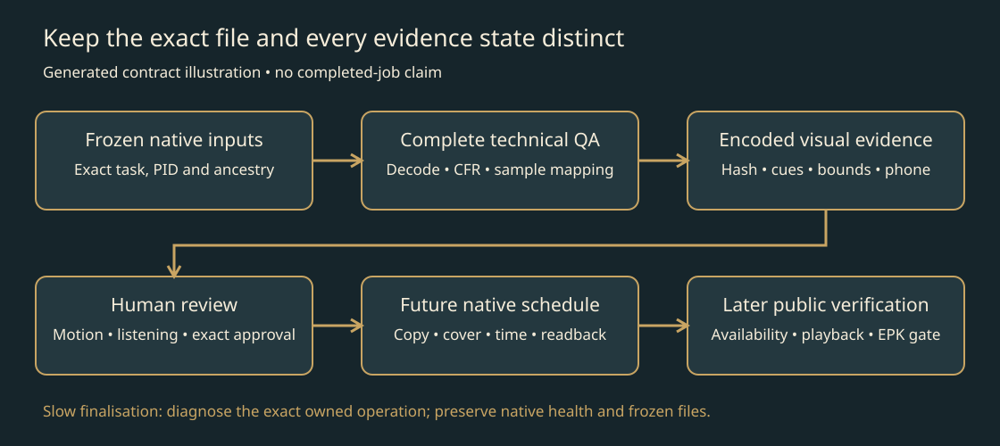

# Verify an exact rendered music video

Use this after a native FrameRudiments render or when a render appears to have stopped. Keep the original project, audio, timing, fonts, assets, runtime and interrupted attempts unchanged. This guide diagnoses and verifies existing work; it does not authorise new generation, a restart, reduced quality or publication.

*Generated contract illustration, not evidence that a job passed.*

## Identify the job before acting

Read the owning job's instructions, private coordination and active-attempt record. Record the exact operating-system task/service, run directory, worker and launcher PIDs, creation times, command lines, live ancestry, frozen-input hashes and state/log paths. Process names alone do not establish ownership. Preserve other campaigns and development checkouts.

Check released, installed and imported component identities separately. Use the native FrameRudiments renderer/verification, saved StemLab source evidence and DanceRudiments motion contracts. Keep campaign art in adapters. Do not install a new version into a running job or change frozen files to make a check pass.

## Diagnose a long verification phase

Read file modification times and sizes, current native health/manifest, frame-analysis or chunk receipts, and the exact owned child's command line. Compare two bounded observations of CPU time and I/O counters when necessary. Distinguish encoding, count/probe, every-frame timestamps, full decode, source probing, checkpoint extraction, metadata reporting and manifest writing.

A status file can remain at an earlier phase until finalisation. A changing process phase or finalized checkpoint family can prove progress even when that status is old. Conversely, a live PID or increasing CPU alone does not prove useful progress or a correct output. Read the exact runtime call order rather than guessing from filenames.

A metadata-only executable startup such as `ffmpeg -version` can hold final manifest creation after decoding has passed. Record its elapsed time separately from video-processing time. Read aggregate memory/disk pressure and the owned process priority only when useful. Such observations suggest contributors; they do not diagnose an OS loader, security product or disk defect. A priority adjustment followed by completion is not proof of causation. Normal priority for an exactly identified owned job is a narrow recovery choice, not a default instruction to raise every process.

Do not kill or restart a progressing job. For a real failure, retain errors, confirm exact owned-process exit and input identity, diagnose the failed operation, then physically reserve the complete justified replacement attempt plus 2% before launching it under the supported OS-owned route. Release only each matching stage immediately before replacement bytes are written; keep the margin through technical QA. Do not use a sparse placeholder, an old free-space snapshot or a Codex-owned background process as substitutes.

## Verify the exact final bytes

Require the native final manifest and `candidate-health.json` permitting review. Do not present a renamed MP4 as ready while native health still rejects it. Verify an independent SHA-256 against the manifest and bind every later receipt to that hash.

Inspect native evidence for dimensions, native frame rate, decoded frame count, every-frame CFR timestamps from zero, full-stream decode, expected channels/sample rate, and source/master identity. Verify start-inclusive/end-exclusive sample bounds and the actual trim/repeat/fade filters against the authorised programme. AAC is a derivative: correct sample mapping is not bit equality with PCM. For chunked output, require the contiguous finalized prefix, replay from zero for temporal/feedback state, exact coverage, decoded seam checks, canonical audio muxed once and full assembled-stream QA.

Preserve the artist's final resolution/frame-rate/spatial/temporal quality contract. Duplicated or interpolated frames do not establish native frame rate. Verify sequential feedback counts and actual source-time sampling; installed libraries alone do not establish integration.

## Inspect encoded behaviour

Use actual decoded frames from the exact final file, not composition previews. Include frame zero, the final frames, every lyric/cue state, adjacent boundary frames, prop entry/exit boundaries and the important authored trajectory points. Batch checkpoint extraction with the maintained renderer where supported. Keep frame number, output seconds, source seconds and signed lyric quantisation error distinct.

Inspect at native size and phone size. Check title/artist identity, canonical words and punctuation, contrast, safe areas, faces, sprite alpha edges and the ending. A contact sheet supports sampled visual review, not continuous-motion or attended-listening approval. Inspect real destination overlays and the exact native upload preview before scheduling; an offline text rectangle alone does not prove platform fit.

Eight-source-time shutter integration can blend adjacent lyric states in a boundary frame. Inspect the actual preceding/onset/following frames and record the observed behaviour; do not silently move canonical onsets or call a sampled blend an unrelated text corruption.

Check transformed bounds for each moving prop. Reports may contain only the visible intersection with the canvas, so an extent ending at canvas width does not prove the whole transformed sprite stayed inside. Document deliberate exits by layer, interval and direction, and inspect encoded entry/tip/fall/exit points. Distinguish intended canvas exits from accidental clipping of faces, lyrics or artwork. Do not turn one creative exit into a general clipping exception.

For contained effects, compare actual pre/post-effect checkpoint pairs and the encoded result. Measure the declared region and representative outside regions, retaining frame, pixel coordinates, scale and differences. Composition, supersampling and antialiasing can affect comparisons; do not claim outside-region stability or musical response merely from loading a shader or recording its configuration.

## Keep canonical caption exports

Retain native SRT/ASS and the native frame ledger. If a destination displays HTML-escaped apostrophes literally, create a separately named upload SRT by unescaping the native text. Verify its complete text and interval mapping against the canonical ledger/native export, hash it and retain both originals and derivative. Do not rewrite canonical words or treat a burned-in caption as proof that an attached subtitle file is correct.

## Deliver and continue without conflating states

Record technical QA, sampled creative review, continuous motion, attended listening, artist exact-file approval, cover check, copy audit, upload, persisted schedule and independently public playback separately. Source-excerpt approval does not approve a materially new generator. A playable exact-file handoff and the user's actual approval are evidence; do not invent listening the agent did not perform.

Present a technically verified film promptly for its authorised review. A future schedule remains separate from publication. Preserve native AI/provenance declarations, current copy/keyword checks, named-zone/UTC time, existing queues, exclusions, exact approval and the public-save gate for later EPK reconciliation. Never backdate or substitute immediate publication or a replacement upload for an unavailable scheduling route.

Complete the owning task's Blogworthiness PASS/FAIL assessment with evidence. A passing creative/technical story retains its angle, current published/pending-draft duplicate review, exact media/public-use blocker and named continuation. Keep private masters, unreleased images, account captures and operational records outside public workflow packages.

## Public demonstration and evidence limits

*Actual public synthetic FrameRudiments 0.1.4 output, not evidence for a later private render or this recovery.*

[Play the public native pipeline demonstration with controls](https://kieransimkin.github.io/DanceFlow/framerudiments.html) and read its [transcript](https://github.com/kieransimkin/FrameRudiments/blob/v0.1.4/docs/media/demo-transcript.md). Dynamic inspection requires an actual demonstration; the diagram above only explains the gate sequence. Reuse public-safe native examples rather than disclosing a private song to illustrate a workflow.

## Potential problems

- **Old health timestamp:** corroborate with exact processes, call order and finalized artifacts; do not overwrite native health to unblock review.
- **Very slow executable startup:** separate startup from decode duration, retain bounded observations and the successful/failed exit. Do not blame the artwork or a security product without evidence.
- **A renderer has no callback for finalisation progress:** retain an independent monitoring receipt rather than editing a frozen runtime. Route a reusable telemetry improvement to its canonical owner after the job.
- **Invisible RGB outside sprite alpha:** a tool preview may show hidden RGB differently. Inspect actual RGBA/alpha and composite the sprite on the intended scene before altering pixels. Preserve originals.
- **Technical checks pass but motion/sound is unreviewed:** hand off the exact file with those states explicit. Do not fabricate an artistic pass.
