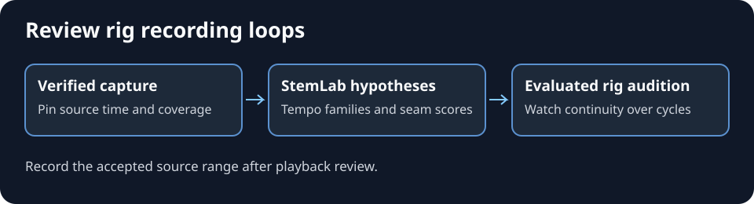

# Review rhythm and loop candidates in rig recordings

Connect DanceRudiments rig captures or verified time-only motion packages to StemLab. Follow the [released rig-motion guide](https://github.com/kieransimkin/stemlab/blob/v1.13.1/docs/rig-motion-analysis.md) for the `stemlab analyze-rig-motion` command, supported inputs and flags. Use the owning native host for audition. See the [public DanceRudiments rig examples](https://github.com/kieransimkin/DanceRudiments#3d-dance-examples) for visual playback examples.

*Generated process illustration. Playback evidence belongs to the exact rights-cleared rig and capture.*

1. Pin the released tools, input digest, representation, timestamps, units and analysed coverage. Verify motion-package chunks. If using a world/contact sidecar, require the exact capture, rig profile and source timestamps. Record downsampling and missing spans. Keyed motion without evaluated rig behaviour supports a narrower review.
2. Retain movement accents, tempo hypotheses with half- and double-time alternatives, and loop boundaries on the source clock. Record sampled windows, pose and velocity scores, root drift, repeat support and available contact evidence. Preserve gaps.
3. Compare with authoritative soundtrack tempo when available. Even a matching pulse leaves beat phase, bar placement and alignment to verify on the soundtrack clock. Any exported source beat map stays provisional until reviewed.
4. Audition shortlisted seams on the evaluated target rig over several cycles. Check pose, velocity, root displacement, foot contact, visible interpolation and intended entry and exit. Record the accepted source range and rig/runtime identity only when that audition passes. Preserve rejected candidates and any manual adjustments.

## Potential problems

- **A repeat occurs late in a long recording.** Inspect the released search's reported windows. Use a synthetic late repeat to qualify window coverage, and record any unsampled time.
- **The result sits at a tempo limit or in another octave.** Keep ranked alternatives and compare against soundtrack evidence before assigning musical meaning.
- **A high pose score hides a bad seam.** Check velocity, root and contacts on the evaluated rig at playback speed. Unresolved source gaps or missing interpolation hold acceptance.
