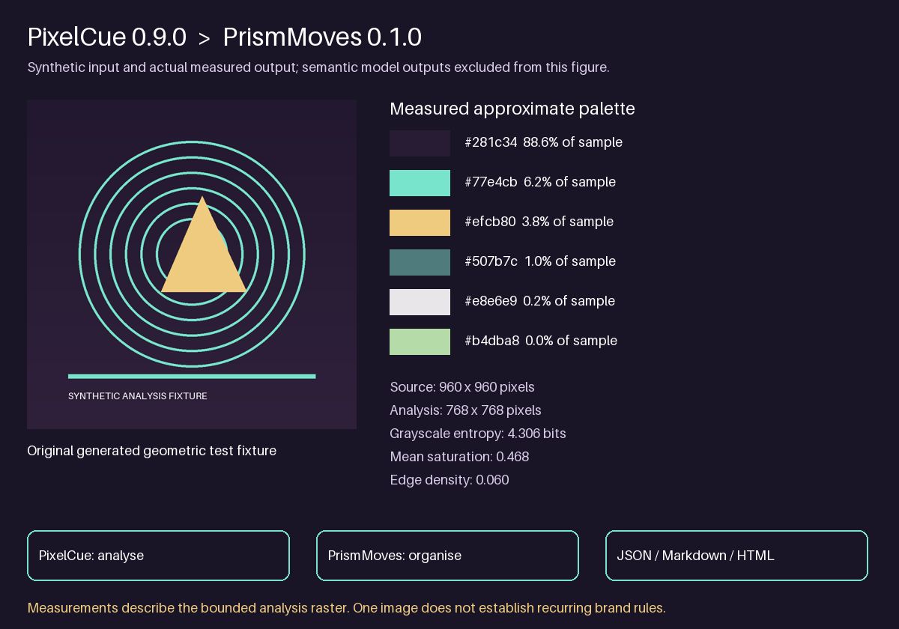

# Full DanceFlow tool use in scheduled jobs

Use this contract when auditing or running scheduled music, media, EPK, research and tool-maintenance jobs. Read the job's current prompt and project instructions first. Existing dates, stop/no-op rules, read-only limits, approvals, privacy and cost boundaries remain authoritative. A prompt update is configuration evidence; it is not proof a job ran or an integration worked.

## Potbot and Unity source previews

Read [the supported host and evidence handoffs](potbot-unity-integration.md). Consider Potbot for authorised coding-agent evidence/jobs and Unity for Unity 6 scenes, shader clocks and source-bound motion. Potbot consuming DanceFlow MCP remains planned; Unity Editor/GPU acceptance is separate. A successful release query with no stable runtime is `no_stable_release`, not current or a network failure. Use pinned source and explicit preview status. Installing guidance does not prove runtime adoption.

## Current release preflight

At the start of every new workflow, use `Tools/DanceFlow.ps1 -Releases` when available and inspect the official stable release of every applicable component. Compare that result with the actual imported, installed or WordPress identity. Read the versioned complete capability index in the released DanceFlow toolkit, including `docs/workflows/framerudiments-complete.md`; do not treat the historical version annotations later in this document as current-release authority. Record unavailable, older, ahead-of-release and unverified states separately. A release check never installs, deploys, downloads models or proves integration by itself.

## Use and improve the shared tools in every chat

The same routing applies to ordinary chats, existing in-progress work at a material handoff and scheduled jobs. Use FrameRudiments as the shared offline renderer, with saved StemLab evidence and native DanceRudiments movement; use DanceMoves for live web motion. Follow `Workflows/framerudiments-rendering.md` and the applicable rendering, analysis and movement skills. Review a concrete reusable improvement during substantial use and implement it in the canonical tool when useful and in scope, or record why the existing capability meets the need. Publish completed improvements through their established checks and immutable releases. For authorised software releases, use automatic immediate GitHub/registry publication without a separate human gate; preserve the distinct social scheduling and public-site deployment rules.

Choose render ownership before production encoding. Only a full-length video or a representative preflight estimate above 15 minutes goes to an operating-system scheduler/service; keep all other renders inside Codex. Record the estimate and decision, do not treat FrameRudiments' 30-second chunk threshold as a background threshold, and never migrate or duplicate a live job. Read FrameRudiments 0.4.14+ `render-progress.json`/stderr heartbeats for regular status while retaining separate completion and QA evidence.

Shared instructions and prompt fragments make this policy available; their existence does not prove a running chat read them or a scheduled job ran. Keep cross-chat findings in private coordination records and preserve each job's original purpose.

## Establish the capability plan

Use `Z:\My Songs\DanceFlow\ecosystem.md` for membership. Review current released documentation, available commands/APIs, installed/imported runtime identity, reusable workflows and their Potential problems sections before selecting a route. Familiar entrypoints and loaded plugins do not represent the entire tool. Distinguish released, installed, served and merely staged capabilities; inspect tagged docs and feature coverage when release notes are sparse. Avoid historical checkout or policy-only release tags as runtime authority.

For the job's actual work, consider every member below and record a purpose-specific decision: use, conditional on a named task, unavailable with an exact cause, or not applicable with a reason. Use all relevant capabilities that serve the intended result, including established ones. Combine existing tools through supported file/API contracts before creating a parallel engine. Do not add effects, media processing, face training, paid research or new work simply to exercise every tool. A read-only analytics run can correctly use one tool while a new EPK/video job may require several.

| Tool | Capability review and suitable work | Evidence and limits |
| --- | --- | --- |
| **StemLab** | Reuse saved stems/analysis; separation choices, master/percussion beat hypotheses, tempo changes/grid precision, onset/meter/groove, structure/harmony/tuning/melody, loudness/timbre/stereo, canonical lyric/word evidence, repetition diagnostics, prosody/semantics, cue-to-grid review, strict/phrase loops, MIDI and independent evidence models. Audio-derived recording/pair/smoothing, Fourier buckets, clip mapping, StemEdit fixed/variable beat/lyric/word/cue editing, StemMoves and selected-source lyric audition complement catalogue matching. | Use `Tools/StemLab.ps1`; verify the current released and installed identities separately. The 1.6.0 Fourier source workflow is not by itself evidence that its runtime is published or installed. Preserve master hashes, source clocks, detector provenance, canonical locks, the 70% lyric threshold and listening gates. Select only needed models; existing download/licence permissions still apply. |
| **DanceRudiments** | Inspect the complete applicable native catalogue and descriptors; custom curve/LFO/sample/seeded-random and rational-beat event/gesture authoring when a catalogue movement cannot express the brief. Use native C++/Python/WASM/bindings, bounded custom libraries, recording playback and the actual comparison harness. | The current reference includes typed rig profiles/motions, Rigify catalogue/import/bake and finite native playback; verify the exact installed 0.4.x API. Legacy XYZ patterns wrap at their own periods; arbitrary-dimensional recordings stop at their capture bounds. Keep integer 64-pip positions distinct from DanceMoves ticks; never copy the motion engine, silently interpolate, invent poses or infer live-runtime support from an offline package. |
| **FrameRudiments** | Shared deterministic Python/Pillow/FFmpeg rendering with 223 released renderers, including the 0.4.1 rangoli Bezier-petal renderer, plus modular particles, bars, waveform traces, XY paths and calibrated spectrum/peak views. It supports full-frame Butterchurn/pinned projectM feedback, kaleidoscope and Julia effects, lyrics, native sprite/atlas motion, source/sample/frame ledgers, canonical LRC/CUE captions and SRT/ASS, layers and mattes, native named/table/composite/matched motion, bounded N-D recordings, exact excerpts/repeats/fades, controlled tone/noise/silence response probes and final-file QA. Keep campaign-specific scene drawing in adapters. | Run the fresh DanceFlow release preflight before use, then verify the imported runtime. Use `Tools/FrameRudiments.ps1` and `Workflows/framerudiments-rendering.md`. Reuse saved StemLab outputs and native DanceRudiments rather than duplicate their engines. Hash master/assets, preserve 60 fps by default, sample/frame timing and caption evidence; retain the hashed per-frame Fourier peak/hold sidecar; retain exact effect runtime/preset pins, causal soundtrack PCM and cleanup receipts; inspect processed glyphs/safe zones and replay sequential feedback. Controlled probes establish input response; they do not establish musical quality. Decoded technical checks do not replace visual review or attended listening. |
| **DanceMoves** | Review scoped browser/React/Next and WordPress composition; musical/media clocks, cue/lyric parsing and subscriptions, native rudiments, particles and effect/rendering primitives, sprite and lyric stages, pointer/hover/phone input, shared/child native and YouTube transport, seek/state restoration, visibility, adaptive quality, diagnostics and teardown. Node signing/private capture services apply only to an actual authorised server task. | Shared owners must be registered and connected to painted consumers. Verify play/pause/seek/end, source/offset mappings, sensor data and neutral/reset states, reduced motion, forced colours, input storms, quality downgrade/recovery and listener cleanup as applicable. Current authenticated capture requirements cannot be replaced by public tokens. No page-specific engine branches or public deployment without the existing gate. |
| **KeywordMoves** | Review source-native workbenches and evidence/import/monitor/compare routes; literal source-span extraction, spaCy/NLTK/KeyBERT when warranted, explicit semantic proposals, bounded research batches, candidate focus/shortlist and reviewed native platform observations/exports. Use supported native Google Trends collection and provider adapters only with available authorised access. | Do not reduce it to free-text keyword generation. Retain dates, source, geography, periods, units, censoring and actual metric scope. Local phrases, relative indices, third-party estimates and native demand remain distinct. Use exact register keys and fresh validated merges; no new account, paid collection, secret extraction or unsupported scraper. |
| **RasterMoves** | Review model/plugin selection, dry-run discovery, bounded comparison and resume, tiling, memory/precision/device controls, target sizing, alpha preservation, batch operations, checksums/provenance and traces. Use opt-in diffusion refinement/protection masks only when the creative task calls for generated detail. | Preserve canonical artwork, original lettering and a baseline. Refinement synthesises detail; it does not recover verified source information. A full catalogue sweep or multi-GB model download is not a routine audit requirement. Verify dimensions, alpha/crop/edges and visual identity in the actual derivative. |
| **LikenessForge** | For an authorised face/identity image task, review face indexing, detector/segmenter/modifier/trainer plugins, repair and bounded repair-wizard comparisons, training preparation/holdouts and LoRA train/train-wizard settings, low-VRAM paths, seeds and traces. Follow `Workflows/likenessforge-image-preparation.md`. | No automatic portrait training or face processing in unrelated jobs. Keep originals, references, identity weights and private evidence controlled. Human likeness/full-composition review is separate from pipeline completion. Check model terms/download permission and real hardware; the source hub has typed bounded repair/training jobs; verify its published/installed version and explicit effect gates before use. |
| **PixelCue** | Reuse scoped local media discovery, available VLM tagging, image/video/archive analysis, visually diverse video frames, search/filter/tag-cloud workflows and permanent analysis history/resume. Use documented loopback REST/Socket.IO service only when needed; optional face clustering has its own relevant scope. | Limit scans to the authorised media set and preserve history. Inferred tags, attributes or clusters are proposals, not identity, subject, rights or genre authority. Do not scan unrelated private folders, expose the service, or download heavy VLMs merely to exercise it. |
| **ThumbMoves** | Use existing OS thumbnail-cache access for low-cost media inventories, candidate galleries and previews before decoding full sources where appropriate. Retain cache hit/miss and backend state. | Strict cache-only API: a miss is unavailable, not permission to open the original or generate a thumbnail. macOS lacks the public equivalent and returns a miss. A cache preview does not prove full-image/video quality. Lives under PixelCue's `packages/thumbmoves`, with separate `thumbmoves-v*` tags. |
| **React Timeline Sequence** | Use the actual reusable timeline for synchronized transport, generic lanes, zoom/pan/seek, buffered playback and loop regions; use composite waveform/spectrogram source lanes and display controls where supported. Keep StemLab's analysis/input-to-lane adapter ownership separate. | Inspect the rendered component; a drawn imitation or static image does not establish UI behavior. Confirm source/clock, sample-exact loop bounds and display/data distinctions. Reuse through the released package rather than a copied timeline engine. |
| **EPK Social Metadata** | Review canonical music/page/audio facts, descriptions/artwork dimensions, descriptive phrases, OG/X fields, music/webpage JSON-LD, verified public video/VideoObject/player-card controls and guarded imports. Relevant to EPK, catalogue, preview and search/social audits. | WordPress owns document title/canonical/robots/sitemap; avoid duplicate owners. Verify exact public source, dates, duration, thumbnail, saved embed and actual playback. Unknown facts stay absent. Metadata correctness does not prove a search thumbnail/player card appeared or rankings improved. Public metadata saves retain their gates. |
| **DanceVault** | Consider encrypted, password-controlled delivery, recipient links, expiry/revocation, source/container hashes and host/security acceptance only when an authorised private-file delivery or maintenance task needs it. | Stable 1.0.0 has verified real Apache/nginx acceptance on the supported WordPress/PHP test matrix. A README-policy release is not a new runtime, and the destination production host still needs its own deployment acceptance. No default deployment, password/access change, sensitive upload or plaintext fallback. It does not replace normal public EPK review audio. Establish current installed/hosted acceptance before use. |

| **Potbot** | Durable coding-agent task/contract/artifact, budget and invocation records; PostgreSQL jobs, REST/WebSocket progress and scripted patch handoffs on its own qualified host. | Source 0.5.0.dev2; no stable release at audit. DanceFlow MCP consumption remains planned. Do not start services, inference or downloads for an inventory. Local model entries are unqualified until real host acceptance. |
| **DanceFlow for Unity** | Unity 6 UPM clocks, 16-tick/64-pip timing, verified StemLab variable tempo, shader phases, finite recording/GPU windows and preview typed rig/Playables playback. | Source 0.5.0-preview.1, no stable release; use the four opt-in samples. Preserve master/profile hashes, independent recording clocks, explicit mapping and finite bounds. Managed/static tests do not establish Editor/GPU or real-character acceptance. |

Short Shifter is an independent project, explicitly outside DanceFlow. Existing independent workflows may still use it when applicable, without adding it to this membership inventory.

## Apply the plan to the job

- **Campaign/media preparation:** combine canonical analysis and selection, supported native motion, scoped image/media preparation and searchable asset/thumbnail review as useful. Use KeywordMoves for evidence-backed copy/targeting and EPK metadata for actual page tasks. Review all visual/audio handoffs, hashes, source offsets, transformed extents, phone crops, first frames, loop seams and final listening. Likeness repair, custom authoring, refinement and private delivery are conditional, not default steps.
- **Analytics/search/social monitoring:** use source-specific KeywordMoves imports, observations, completed-period comparisons, focus/shortlist and evidence history where useful. EPK metadata/page checks apply only within the job's stated inspection scope. Do not turn a read-only dashboard run into generation, downloads, source changes or publishing. Native platform connectors remain the evidence source.
- **EPK/catalogue audits:** inventory actual media/timing/metadata and every applicable DanceMoves owner/controller/painted consumer. Use StemLab/Timeline/clip evidence only for real audio or mapping questions. Prepare visual derivatives only for an evidenced asset gap. Keep source authority, exact-candidate saving, hosted-byte/playback checks and anonymous responsive verification separate.
- **Lyric/timing recovery:** use current StemLab analysis/evidence and real timeline inspection where they answer the question; preserve the job's authorised Suno V1/V2 route and existing canonical-word scoring/export adapter when that contract is still needed. Do not silently replace the 70% threshold, programme identity or user-edited locks with a forced-alignment score. Migrate a reusable gap through the shared tool only with demonstrated parity and the existing source authority.
- **Outreach/publicity/blog jobs:** use the existing canonical ledger, original outcome evidence and rights gates. KeywordMoves can help review venue-specific language and source history; visual tools apply only to authorised illustration/asset work. No generated asset, invitation, receipt or aggregate metric establishes independent publicity. Private delivery remains conditional on actual approved recipient need and a verified supported route.
- **Tool/release/review maintenance:** review the tool's full affected API, integrations, tests/docs, package manifests, build/release and registry routes. Compose relevant ecosystem tools rather than extending private forks. Preserve runtime/source/package identity, immutable versions and separate live-site/access gates. A configured reviewer requirement is distinct from CI and registry acceptance.
- **Work-search and freelance administration:** consider KeywordMoves' existing generic literal/NLP and reviewed observation/import/comparison routes for job/skill matching, profile observations and Etsy keyword research when they materially serve the original task. Keep outputs, caches and private evidence inside the owning HunnyBee service/job/competency boundaries; never mix them into song keyword records. No supported native provider is implied for a platform that lacks one. Use already available generic routes only where their real schema fits, otherwise retain native evidence and record the exact gap. This adds no music generation, media scan, face training, paid source, new model download or account/publication duty.
- **Benefits reconciliation and unrelated research:** record no applicable workload where that is true. Preserve paused jobs and current specialty tools. A possible generic text extraction is not enough to add a tool when it offers no concrete benefit to the job's actual purpose.

At a substantial tool use, identify a concrete improvement opportunity. Where already authorised, implement the smallest useful reusable fix in its proper tool, with relevant tests, README, example, owned PR, exact-revision CI and matching release/registry verification. If the existing capability already meets the need, record why no change is justified; if source work is outside the job's allowed scope, retain a precise improvement proposal. Do not create activity solely to satisfy an improvement quota.

## Profile visualiser input response with FrameRudiments and PrismMoves

Use FrameRudiments 0.3.0+ `presets-install` and `presets-profile`, or its maintained
`scripts/profile_visualisers.py`, to compare Butterchurn/projectM presets. Read
`Workflows/framerudiments-preset-profiling.md` and the canonical
[capture and synthesis workflow](https://github.com/kieransimkin/FrameRudiments/blob/v0.3.0/docs/preset-profiling.md).
The separately installed pinned catalogue has 14,680 distinct upstream entries
and 67 shared textures; membership is separate from actual GPU acceptance and
public-use rights. Preserve source notices, preset/runtime hashes and aliases.

For the My Songs reference experiment use the directly selected Arcadians and
The Truth is a Virus, each with canonical master, cover and timed lyrics. Keep
their inputs and reports private. Cross cover/lyric composition and the three
static cards with programme/silence controls; replay every preceding feedback
frame and capture the declared output intervals. Record source offsets, sample
bounds, source/output clocks, frame rate, mix and actual cleanup. Preserve the
published source-bound beat adapter and original-time lyric/recording contracts.

Invoke the maintained PrismMoves Python runtime (PrismMoves 0.1.0/PixelCue 0.9.0
verified baseline); use PixelCue's actual statistics/comparison API instead of
copying analysis. Keep optional model hypotheses and unavailable states distinct,
with local weights/caches under the owning experiment models/. No automatic
downloads or expensive full sweep is implied. Benchmark an explicit batch before
extending it; retain completed, failed and untested coverage separately.

Combine measured source/output, temporal, programme/silence and shared-card/tune
comparisons into condition families and response ranges. Review palette, luminance,
edges/symmetry, texture, spatial frequency and actual text treatment before writing
a visual thesis or invariants. Near-duplicate frame grabs share a lineage; do not
invent one overall brand/quality score. Keep legibility, flash safety, musical
approval, rights and final encoded-video QA as separate evidence.

Generated test-card illustrations. [Play the actual full-frame pipeline example](https://kieransimkin.github.io/DanceFlow/framerudiments.html)
with user controls and transcript; that earlier software demo is distinct from
the private real-song profiles. Keep raw PrismMoves reports, captured PNG hashes,
resume settings and failure receipts. A stored rule does not prove another chat
adopted it or that every catalogue entry has been profiled.

## Retain proof of actual use

In the job's existing dated report/ledger, record the relevant capabilities selected, purpose, actual runtime/source identity, input/output/report hashes, supported handoff and verification result. Distinguish considered, available, invoked, produced, reviewed, approved, scheduled and verified-live states. Retain exact unavailability/omission reasons; reuse a current applicability baseline when scope and capabilities are unchanged. Tool names in a prompt, a loaded library, schema fields or a passing synthetic test do not prove integration or an artistic outcome.

Scheduled prompt changes must use the supported automation update control after reading current definitions. Re-read immediately before each change, preserve all other prompt content and metadata, then verify persisted prompt hashes and unchanged name/kind/status/schedule/expiry/target/model/notification fields. Update paused prompts only when relevant while retaining pause state. Do not create duplicate jobs, run them for validation, expand authority, or rewrite scheduler TOML directly.

## Potential problems

- **Several directories appear to contain the same jobs:** resolve documented filesystem aliases and compare IDs/hashes before counting or updating. Here the C-side automation root is a junction to the Z-side root; 60 aliases matched 60 unique definitions on 15 October 2026. Do not perform a duplicate pass or edit either alias directly.
- **Old/new managed blocks coexist:** identify each known block exactly, merge from fresh current prompt and replace only the owned block. Preserve unrelated instructions, date windows and gates. Modified predecessor text requires review; silence is not ownership agreement. Use one current ecosystem block and one applicable StemLab block, then re-read the persisted job.
- **Latest GitHub release is not a runtime release:** DanceVault's README-policy tag illustrates the problem; ThumbMoves has separate prefixed tags inside PixelCue. Inspect package assets, prerelease flags, source version and installed capability rather than taking the repository's latest tag as a deployable version.
- **Broad tool-use wording expands the job:** explicit role/applicability decisions and the original scope/stop rules take priority. Complete authorised useful work; no automatic model sweeps, LoRA training, deployment, spending or publication from an inventory checklist.

Authority: current tagged READMEs and capability docs in the repositories linked from `DanceFlow/ecosystem.md`; use current versions at action time. Local method verification on 15 October 2026 distinguishes the saved job instruction from any later execution result.

## PrismMoves and PixelCue visual evidence

Use PrismMoves for broad image-understanding reports and PixelCue for the shared decoding, measurements, model adapters and existing VLM tagging. Use Tools/PrismMoves.ps1 or the supported Python/service route in Workflows/prismmoves-visual-analysis.md. The hub's pixelcue_visual_analysis MCP tool returns a PixelCue receipt; PrismMoves creates JSON, Markdown, HTML and SVG reports. Select only useful authorised models, retain unavailable receipts and keep all weights/model caches in the owning project's ignored models/. One image does not establish recurring identity rules; use approved independent comparison evidence. This routing is configuration, not proof of adoption by another chat.

Generated measurement figure; not a UI screenshot or proof of semantic accuracy.

## Project-local model storage

All DanceFlow projects store downloaded model weights and model-specific caches inside the owning project's models/ and add models/ to .gitignore. Configure framework cache roots and adapters explicitly; retain revision/licence/hash manifests and exclude weights/caches from distributions. Choose only task-relevant authorised models. Do not silently migrate or delete existing weights: inventory references, preserve originals, verify loading at the new path and update consumers. Shared guidance is configuration, not evidence that another running chat adopted it.
