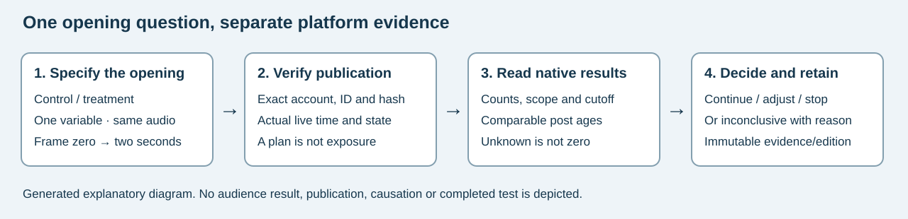

# Learn from published Shorts and test stronger openings

Use a source-backed retrospective to improve the next clip on each platform.
Read the current campaign plan, publication ledger, artist/account identity and
latest compatible platform report first. Preserve existing approval, privacy,
cost, rights, publication, scheduling, active-date and stop rules. A test plan
does not publish a variant. Keep a report's local publication distinct from
public disclosure of private account analytics.



*Generated explanatory diagram with synthetic labels, not evidence that a video
was published, a test ran or a platform outcome improved.*

## Keep five outcomes separate

Record exposure, qualified viewing, watch depth, audience response and full-song
listening separately. Views are neither unique people nor streams. Native follows,
saves, shares and comments can diagnose audience response; they do not prove
listening or endorsement. Inspect comment sentiment only within the existing
privacy scope. Do not pool artists or compare raw view totals across platforms.

Retain all relevant published IDs, exact observation times, source cutoffs,
definitions, units, windows, candidate/source hashes and geometry evidence.
Exclude future schedules, unlisted/private assets, photos and unrelated full
films from a published 9:16 comparison. Keep unknown geometry explicit rather
than inferring portrait from a Shorts/Reels label. An unresolved older post
belongs in the gap register, not a zero or a silent deletion.

## Platform decisions

| Platform | Useful primary opening measures | Guardrails and concrete decision |
| --- | --- | --- |
| YouTube Shorts | Stayed-to-watch versus swiped-away when exposed; engaged views and their counts. | Keep starts/replays, engaged views and conditional APV/AVD distinct. An APV above100% is not an all-exposure completion rate. Quarantine extreme tiny-sample averages. Test an immediate comprehensible predicament or refrain against a delayed opening on the same excerpt; do not copy a TikTok winner without a YouTube comparison. |
| TikTok | Native one/two-second retained audience, average watch time and full-watch percentage, with video-view counts. | A largest-loss label locates a drop but does not quantify its size. Calculate average percentage watched only with a finite positive exact loaded native duration, preserving source and time. Test a visible promise/payoff in the first two seconds. Native post-attributed follows are gross events, not account net growth or streams. |
| Instagram Reels | Native watch depth where qualified, then saves, shares, follows and relevant profile/listening-route actions. | Views, reach and viewers have separate definitions. A game/joke format may win reach without response. Test the immediate objective first; test a reason to follow/listen separately. Do not divide total watch by an invented denominator. Reels can include full landscape films. |
| Facebook | Actual published visibility, distribution/viewers and eligible watch data first. | Zero-distribution rows cannot establish a failed creative opening. Diagnose account, public visibility, processing and native reporting before changing media. Once distributed, test the same concrete opening with the platform's exposed retention measures. |
| X | Native video views, unique video views and exposed retained points; attributable link clicks separately. | Public post views/impressions are not native video views. Shared-video counters can span posts and cannot be summed as unique viewers. Do not upgrade analytics or spend automatically. Tiny audiences yield inconclusive creative comparisons. |
| LinkedIn | Video-view counts and native watch time, with relevant engagement or route actions. | One-to-four-view averages, especially longer than the clip, cannot rank openings reliably. Diagnose distribution and professional-audience relevance. Do not manufacture a completion percentage from a repeated-watch average. |

These are metric-selection rules, not universal algorithm benchmarks. Keep
first-party definitions and the actual native UI authoritative when they change.
An existing release-specific requirement remains in force.

## Write the opening test before rendering

Use one variable per pair. Retain both an understandable control and a concrete
treatment. For example, keep the identical soundtrack, duration, caption,
typography, cover policy and post-opening edit, and vary only whether the central
predicament is visible during seconds0–2. A changed excerpt is a separate audio
test; if its length or words also change, record the confounding variables.

Every registered test needs:

1. Stable test ID, artist/release, platform, owner, hypothesis and state.
2. Exact control/treatment source hashes and canonical audio bounds when ready.
   A proposal without approved media remains `planned`, not production-ready.
3. Frame-zero, first0.25-second, one-second and two-second visual promise;
   first audible/sung phrase; timing of meaningful development and payoff;
   phone readability and exact caption-to-content expectation check.
4. One changed variable, held variables and unavoidable differences. Keep a
   historical sibling comparison separate from a new controlled pair.
5. Platform-specific primary metric, counts/denominator, watch/meaning quality
   guardrail and downstream response/listening diagnostic.
6. Comparable publication age, source window, cutoff and audience context.
   Request24h,72h and seven-day reads on the next eligible existing job; those
   are review ages, not permission to create more scheduled runs or notifications.
7. Predeclared adequate-exposure rule and continue/adjust/stop/inconclusive rule.
   A proposed count such as100 engaged views or500 starts is an operational review
   trigger, not a power calculation or proof of significance. If the channel is
   too small, retain exact counts and repeat comparable pairs.
8. Actual native publication IDs, verified live times and media/copy identities
   after publication. Reconcile existing queue/ledger state before any upload.
9. A falsification condition and next review owner. Do not declare a winner from
   one percentage, one upload or an unjoined historical test file.

Use recognisable song meaning, a complete refrain, visible goal, problem,
transformation or deliberate tension as creative hypotheses. Do not turn
politics, game graphics, expensive art, a clip length, a font, an AI model,
hashtags or frame rate into a proven growth formula. A quiet contemplative
opening can be valid; specify the reason to stay rather than adding noise.

Preserve the song's canonical lyric/timing authority, unique cover/artist/title,
platform safe regions, accessibility and at-least60fps target. Use maintained
StemLab selection evidence, FrameRudiments composition and the storyboarding
workflow when actual production is authorised. Do not generate assets or alter
posted media merely to complete this analytical workflow.

## Update the local living report

The portable `tools/shorts_report.py` accepts saved source-hashed observations.
It has no network, social-post, scheduling, email or spending functionality.
Use an owning-project configuration for artist/accounts, evidence root,
immutable baseline dataset/report/PDF, report root and test register.

An observation uses schema `shorts.observations.v1`, exact verified account,
stable run_id, offset-bearing observed_at, status, coverage and a saved evidence
path/SHA-256. Each published post has its actual ID, explicit format state and
metrics with values, native definitions, units and exact lifetime/since-published
cutoff or period start/end. Null is unavailable. Full-life headline cells retain
their source dates; incompatible periods/definitions remain separate series.
See `examples/shorts-observation.json` for synthetic field names and values.

```powershell
python Tools/ShortsReport/shorts_report.py --config PRIVATE_CONFIG validate --snapshot SNAPSHOT
python Tools/ShortsReport/shorts_report.py --config PRIVATE_CONFIG ingest --snapshot SNAPSHOT
python Tools/ShortsReport/shorts_report.py --config PRIVATE_CONFIG publish
```

Use the configured PDF runtime with ReportLab and pypdf when PDF updates are
enabled. Inspect the actual runtime and preflight temporary-directory access.
No package/model download is implied. Missing PDF dependencies hold publication;
they must not leave a new partial stable report or erase the prior edition.

Ingestion archives the exact hashed source bytes and retains their original path,
so reuse of a dashboard capture filename cannot invalidate the historical ledger.
Pin baseline dataset/report/PDF hashes in the private configuration; a mismatch
holds publication. The publisher retains immutable observations and dated editions, then replaces
the stable local view only after building all files. The manifest is committed
last; consumers verify its hashes or read the immutable edition it names.
An atomic writer lock prevents two publishers; leave a conflicting contribution
pending and do not remove another owner's lock. Identical run replay is
idempotent; different data with the same run ID is held for reconciliation.
Old cutoffs cannot displace newer data just because they were read later.

For access holds or genuine no-change work, retain a source-backed status
observation without invented post measurements. Do not rerun all platforms or
render another edition merely for a no-op. Keep each platform's existing
cadence, batch limits, resource lease and five-action/report requirements.
Review previous tests only when their publication and exposure are qualified.
Record an improvement or why the current route suffices; do not expand into
automatic media production, publication, paid analytics or model runs.

## Acceptance and known failure modes

- Wrong artist/account, changed evidence hash, scheduled/private item or fabricated
  geometry: reject the contribution; continue unrelated authorised work.
- Same run ID with different content: hold, preserve both candidates and reconcile.
- Changed native definition, incompatible window, decreasing revised count or
  sparse sample: preserve the source and scope; do not force a growth story.
- Historical lyric/caption promise arrives after observed drop: register an
  earlier-promise test, not a proven cause or wrong-file diagnosis.
- An old test file has no native ID: keep it unresolved until an exact publication
  receipt establishes identity; never call it a completed experiment.
- Report configured/updated: proves file persistence and analytical wiring only.
  A future job must actually collect evidence, invoke the route and read back the
  edition before adoption or audience improvement can be claimed.

Record Blogworthiness: PASS/FAIL with reason and evidence in the existing report.
For PASS preserve duplicate review, reader angle and delivery state. Private
analytics remain private unless their exact disclosure is authorised.
