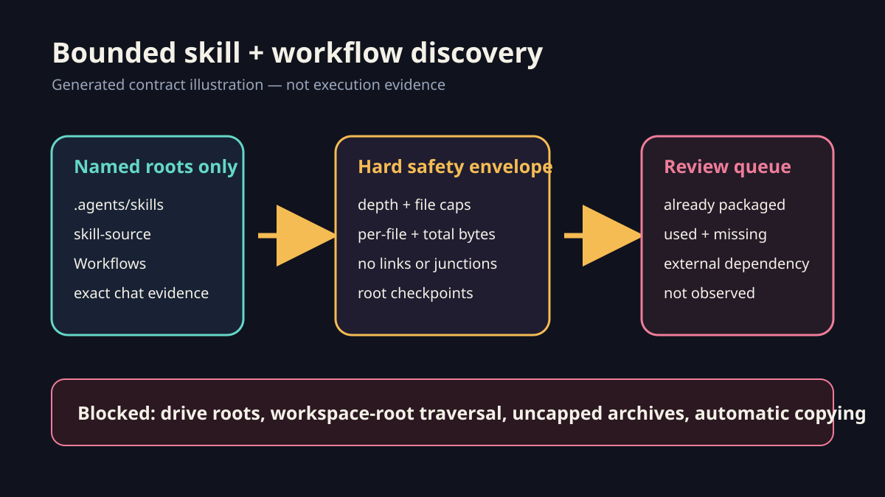

# Bounded skill and workflow discovery

Inventory reusable skills and workflows from known locations, then compare them with bounded evidence of actual project-chat use. Do not crawl a drive, a whole workspace or every report. The result is a review queue, not authority to copy private material or publish a package.



*Generated contract illustration. It depicts the scan boundaries; it is not evidence that a particular skill was used or packaged. A video of this static audit would add no explanatory value. Actual private chat evidence stays in the workspace report.*

## Select normal locations

Create a private manifest using schema `workflowmoves.skill-workflow-scan.v1`. Name each location explicitly:

- Project skills: the workspace's `.agents/skills/` and, when present, maintained `skill-source/`.
- Installed skills: the configured Codex skills root. Mark bundled/system/vendor locations `external` or `system`; they are dependencies, not source to copy.
- Project workflows: the maintained `Workflows/` directory.
- Usage evidence: the private `.codex/coordination/` directory plus exact task reports or chat-export files already identified as relevant. Do not add the whole `Reports/` tree.
- Repository coverage: the exact WorkflowMoves checkout being reviewed.

Use absolute paths only in the private manifest. Public examples use synthetic paths. Keep private chat titles, payloads, credentials, rights records and account evidence outside the repository.

## Run the bounded audit

```powershell
python tools/discover_skill_workflow_usage.py private-scan.json --output private-scan-result.json
```

The scanner has no implicit discovery root. It rejects a drive root or the declared workspace root, stays within `allowed_roots`, does not follow symbolic links or Windows junctions, prunes common cache/model/release directories, and enforces independent depth, per-root file, total-file, per-file byte and total-byte limits. It reads only matching `SKILL.md`, workflow Markdown, route JSON and explicitly allowed usage files.

The output is checkpointed atomically after each named root. If the process is interrupted, rerun with `--resume`; resume is allowed only when the exact manifest hash is unchanged. A budget stop retains a partial report with `scan_complete: false`, `truncated: true` and a precise `stopped_reason`. Never raise limits merely to hide a poorly scoped root.

## Interpret results

- `already_packaged`: the normalised skill/workflow identity exists in the repository or in a guarded route target.
- `used_missing`: bounded usage evidence mentions a project-owned identity that is not packaged. Review its source, privacy, generality, overlaps and licensing before adding it.
- `vendored_dependency`: an exact redistributable dependency snapshot and its licence are already retained under `vendor/skill-dependencies/`.
- `external_dependency`: an external/system/vendor skill was observed but not vendored. Check its redistribution licence; retain version/hash evidence and a precise blocker when copying is not permitted.
- `not_observed`: the item was found in a normal location but not in the supplied evidence. This is not proof that it has never been used.

Name matching is a candidate signal, not semantic proof. Read the cited evidence and the complete source instructions before deciding. Consolidate overlaps, preserve narrower approval/rights/privacy rules and package only public-safe general behaviour. When copying a dependency, preserve its complete referenced/associated files, licence, provenance and deterministic tree hash. Never redistribute a proprietary or unlicensed skill merely because it is installed. Use `skill-creator` for a new or materially updated skill, add tests and media where useful, preview guarded routes, and verify repeat installation is current.

## Actual-use reconciliation

For each reviewed `used_missing` item, record one disposition in the private task report:

1. packaged with exact repository paths and tests;
2. already covered under another maintained identity;
3. vendored with its licence and complete associated files, or retained as an external dependency with a precise redistribution blocker;
4. held because evidence or reusable scope is insufficient; or
5. excluded because it contains private/project-specific material.

The audit does not claim adoption by running chats. Re-run against newly identified exact evidence locations rather than broadening to the workspace root. Complete the task's Blogworthiness assessment separately.

## Potential problems

- Missing or unreadable roots are explicit skips, never an empty successful inventory.
- A cap hit is an incomplete scan. Keep the partial output and reduce scope before resuming or starting a fresh manifest.
- A generic word can create a false mention. Inspect the cited file; do not package from counts alone.
- Installed system skills may change independently. Link to their supported identity and record the observed version/path privately rather than copying their contents.
- A repository route can cover a project workflow without storing that project file at the same path. Review the target/source pair before declaring a gap.
- Scanner output can expose private local paths, so keep real manifests/results in private evidence directories and publish only sanitised examples.
