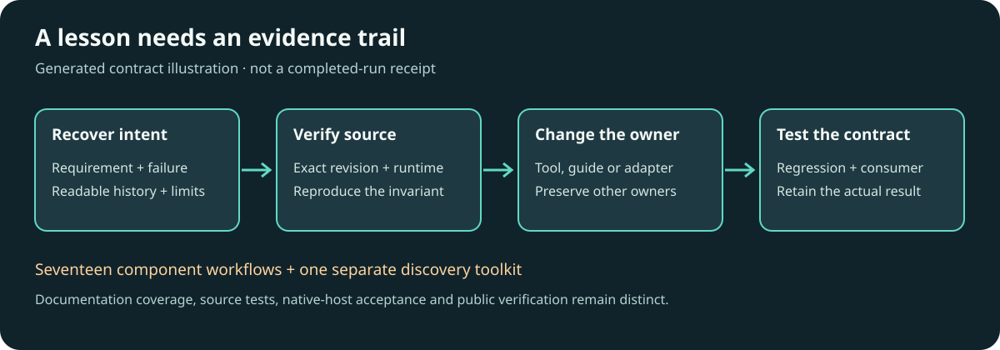

# Turn development evidence into reusable workflows

Use this workflow when a tool task or development-history review exposes a repeated failure, missing composition rule or useful verification technique. Start with the [whole-tool workflow map](ecosystem-tool-workflows.md), current source and actual runtime identity. Preserve the task's approvals, privacy and cost limits; a history review does not authorise another model run or service deployment.

Generated process illustration. It explains what evidence must survive a handoff; it does not establish a successful run. Use actual native screenshots/videos for visual or dynamic claims. Keep private chat captures and personal reference imagery in the owning task's controlled evidence.

## Recover the decision before generalising it

Search both ordinary ChatGPT and Codex histories through supported read/search tools. Include available archived chats and, when authorised, read-only local user transcripts. Distinguish an inventory of titles, a bounded request index, readable messages and a full conversation review. Missing bodies, attachment placeholders, truncation and absent older pages are named coverage limits. Never reconstruct an unavailable reply from its title or treat an assistant's earlier success claim as current acceptance.

Retain a private lesson row containing the original user requirement, observed failure, source/version, smallest reproducible case, current implementation check, relevant verification and disposition. The disposition is one of: existing behaviour already meets the need; owning-tool fix; shared workflow/skill update; project-specific adapter; or precise unresolved hold. Link the public-safe source and tests in reusable documentation, and retain private chat IDs/transcripts only in private evidence. Preserve stricter user decisions; do not carry an obsolete workaround into a newer supported API.

## Reusable lessons and where they apply

| Trigger from development work | General rule and verification | Owner |
| --- | --- | --- |
| Local code passes but committed/packaged source omits new modules or assets | Seal the complete reviewed tree, including new files, licences and runtime resources. Build from that exact checkout or archive in an isolated consumer; exercise the actual entry point. A tracked-file-only commit or Dockerfile that reclones remote main cannot verify uncommitted changes. | Owning package/build tool; release workflow |
| An editor render can overwrite a recording or an earlier output | Separate immutable inputs from uniquely named derived outputs and revision snapshots. Use atomic creation/conflict checks where concurrent output is possible. Compare input hashes before/after, attempt an existing-output collision, and retain the original project schema for compatibility. | Editor/export backend; caller supplies the authorised output parent |
| A rig hash fails after calibration or precision changes | Identify every representation of the same geometry, including source skeleton and compiled joint/control lengths. Normalise through the canonical compiler and recompute the complete semantic identity, then compare against an independently reviewed pin. Never make a mismatch pass by copying the reported actual hash without checking the changed geometry and source identity. | Rig/profile compiler and release fixture |
| A successful mesh demo shows a substitute character | Name the requested character, target mesh/materials, source skeleton and retarget mapping separately. Verify the actual painted character and calibration, not just bone activity or a scene load. Check both the native consumer and its deployed example where claimed. | Rig/Unity adapter and visual acceptance |
| A shared effect upgrade changes the approved page appearance | Capture the original full-page stack and measure opacity, blend mode, texture, movement extent and painted coverage before migrating owners. Compare the whole page and below-fold consumers at representative viewports; a correct API call or hero screenshot cannot establish visual parity. | DanceMoves integration; page-owned appearance adapter |
| Motion appears at the wrong musical speed | Preserve original source clock and finite bounds; compare half/original/double-time hypotheses and canonical versus inferred BPM independently. Keep first-beat offset, tempo family and seek origin explicit. Preview-rate controls do not establish beat matching. A motion-tempo confidence threshold is distinct from lyric-match confidence or loop-seam acceptance. | StemLab timing evidence, DanceRudiments playback, destination adapter |
| A media demo changes page before a test can select an item | Keep real asynchronous request callbacks active and observable, but make fixture state changes explicit and deterministic. Record observer pagination requests; use deliberate Previous/Next actions to change test data. Exercise the production controller separately instead of disabling its callback to make the demo pass. | MediaSlide or host demo harness |
| Static frames appear to describe a dynamic visualiser | Use source-bound, chronological frames and programme/silence/probe conditions. Keep the output content hash independent of preset/reference filenames. Review isolated output and condition contact sheets; retain previous reports and distinguish measurements from model interpretations. | FrameRudiments capture, PixelCue measurement, PrismMoves synthesis |
| A release exists but one distribution/demo is broken | Track source/commit, package contents, registry, example build, deployment and actual consumer as separate rows. Check required downstream jobs on the exact revision; a copied subset is not a whole-package import test. Preserve immutable failed/partial versions and issue a new version for corrected bytes. | Owning release workflow; ecosystem availability records |
| Users cannot tell which release archive to use | Name each asset by platform, architecture and binding where applicable; include its licence, manifest, checksum and a minimal consumer command. Verify archive contents and registry versions independently. Keep ordinary CI validation separate from release-only publication, and label optional/unavailable distributions explicitly. | Owning package/release workflow |
| One adapter is demonstrated behind a language-neutral tool contract | Negotiate each backend's supported operations and expose unsupported ones explicitly. Qualify one real reference fixture before extending to another language, remote host or device. Bind inspection handles to the current stopped-state revision and reject them after resume; retain source/target identity. One Python walkthrough cannot qualify other languages or hardware. | Shared contract and adapter conformance; each native target owns its acceptance |
| A model, platform or security feature is registered but cannot run on this host | Qualify the actual selected dependency path and native host. Keep unsupported/unqualified states explicit and fail closed at the owning boundary. Do not broaden access, substitute unrestricted execution or silently fetch a model to turn a catalogue entry into a success. | Native host/tool; project-local model/cache contract |

## Apply the smallest useful change

Reproduce the useful invariant without a costly full media/model sweep. Fix a reusable mechanism in its canonical owner; retain song artwork, subject choice and scene mapping in the project adapter. If the owning engine already implements the rule, update the caller/workflow or record that no engine change is justified. Do not create speculative fixes for every audited component.

Update the relevant README, native example, specialist workflow and discoverable skill when the new behaviour changes their decisions. Use WorkflowMoves' guarded route preview/apply/repeat flow to propagate shared text while preserving project-owned instructions. Run the relevant regression, installed-package/consumer checks and required CI. Publish authorised software through its established immutable release route; keep public-site saves and deployment authority separate.

Run `python tools/audit_workflow_coverage.py` after a membership or workflow change. A passing check establishes that every indexed component has retained inputs, outputs, acceptance/limits and real local route files. It cannot establish that the instructions are complete, a chat search was exhaustive, an external link works or a native workflow actually ran.

## Public source trails for the generalised cases

- [DanceMoves complete-source correction](https://github.com/kieransimkin/DanceMoves/commit/c360545f580e4465b05b4e2ceacfff199be6f391) and its [runtime/browser workflow](https://github.com/kieransimkin/DanceMoves/actions/runs/39105293414).
- [StemLab checked-out-source and actual dependency-path correction](https://github.com/kieransimkin/stemlab/commit/d0846004356510f83659c68bffe7b92efcf3bcd7).
- [MediaSlide deterministic browser-demo correction](https://github.com/kieransimkin/react-mediaslide/commit/f16a8fcc) and [browser/package/deployment workflow](https://github.com/kieransimkin/react-mediaslide/actions/runs/39218212278).
- [DanceRudiments character, calibration, timing and acceptance documentation](https://github.com/kieransimkin/DanceRudiments#3d-dance-examples), [finite recordings](stemlab-audio-motion-recordings.md) and [source-bound native-host handoffs](potbot-unity-integration.md).
- [Controlled capture and temporal evidence](framerudiments-preset-profiling.md), [PixelCue/PrismMoves ownership](prismmoves-visual-analysis.md) and [canonical timing/clip evidence](stemlab-phrase-and-clip-evidence.md).

- [Potbot tool plan 1.3: language-neutral, Python-first debugger contracts](https://github.com/kieransimkin/potbot/blob/tool-plan-v1.3/docs/potbot-tool-mcp-implementation-bundle/potbot-universal-tool-mcp-implementation-plan.md#2c-phone-control-profiling-and-language-neutral-localremote-debugging). This is published planning evidence for adapter negotiation, stale-frame rejection and separate target qualification; it does not establish released debugger, phone or hardware execution.

These sources explain specific changes and contracts. Their existence is not current registry, deployment, physical-device or production-host acceptance.

## Completion and potential problems

Record the lesson dispositions and exact changed routes in the existing task report. Assess blogworthiness from the verified result, with source evidence, duplicate review and a delivery state for a passing story. Do not publish private history or create an article about performing the audit alone.

- A partial history read remains partial even when the workflow-map check passes. Continue useful source work and retain the smallest unavailable-history requirement.
- A confidence value is meaningful only with its schema, metric, population and calibration; do not transfer a 70% threshold between unrelated domains.
- A passing candidate, CI job or source-only static test does not prove the installed/native/painted result. Preserve the exact failed, partial and untested states.
